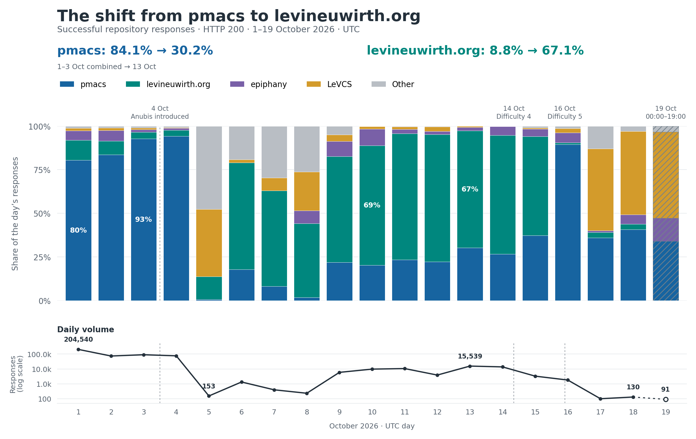
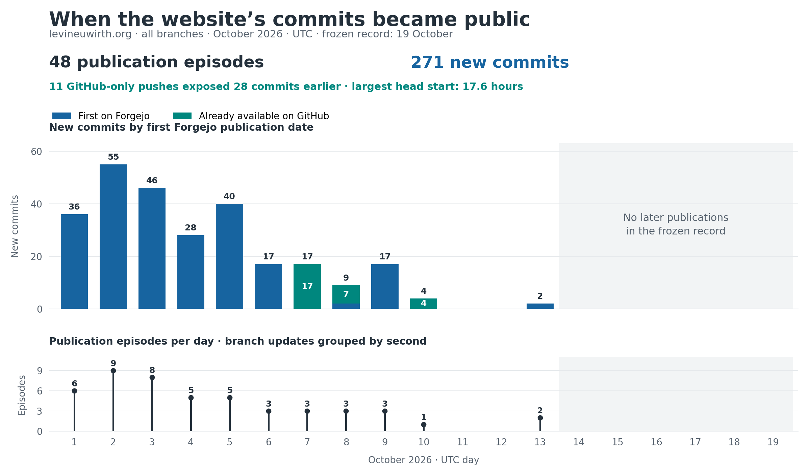
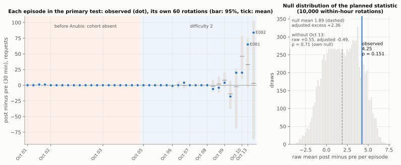
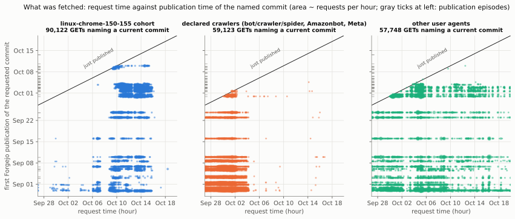
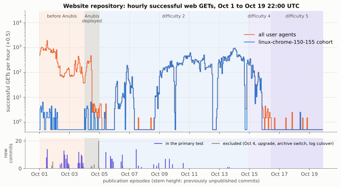
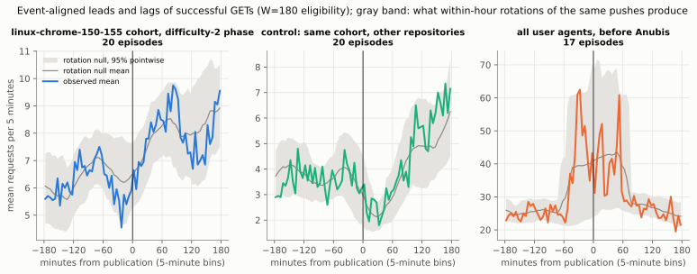
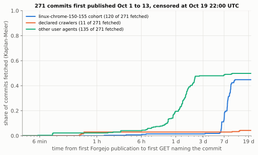

The [Dead Internet theory](https://en.wikipedia.org/wiki/Dead_Internet_theory) posits that the demise of the internet *has* indeed already occurred, and that it is attributable to bots. The theory [as described in 2021](https://forum.agoraroad.com/index.php?threads/dead-internet-theory-most-of-the-internet-is-fake.3011/) was highly conspiratorial, with a sort of peculiarity that undoubtedly provided much of the initial intrigue. Would I, for instance, have accepted the sweeping claims of some coordinated and covert undertaking with advanced intelligences of the artificial sort creating different internets for phones and PCs? Would I have personally believed that [“[Zuckerberg and other tech guys were all on](https://mindseyemag.com/magazine/dead-internet-theory-mot-of-the-internet-is-fake/) [4chan](https://en.wikipedia.org/wiki/4chan) at some point?”]{.link-icons-end}^[Not that I actually had any knowledge then, nor now, of exactly *what* 4chan is or aspires to be, but I disgress. My broadest understanding of this matter is a meme that I saw on Reddit as a high schooler,  who avidly enjoyed r/ProgrammerHumor, in which allusions to the television show Spongebob Squarepants are used to facilitate understanding of the website's rather severe differences in severity.]

While I severely doubt that I would have believed such egregious claims in the year 2021, and thus would have likely dismissed any theories of a "Dead Internet" as nonsense, perhaps the year 2026 has become destined as a time to reevaluate. I formally propose that [levineuwirth.org](/index.html), and more specifically [git.levineuwirth.org](https://git.levineuwirth.org), have unintentionally become a strong piece of evidence for this theory, perhaps even including the [Zuckerberg](https://en.wikipedia.org/wiki/Mark_Zuckerberg) part. Throughout the summer of 2026, automated requests from LLM-related crawlers on this website grew rapidly, surpassing 200,000 per day by October, with over 100,000 coming from addresses affiliated with [Meta](https://ai.meta.com/). This page will serve to capture the ongoing "Crawler Chronicles" as an essential piece of evidence in favor of dead internet speculation familiar and egregious.

## The Forebodings of Mutiny through Maintenance
Regular server maintenance on this website, which is hosted on the same VPS as the Forgejo subdomain, occurs in intervals based on the technical depth. At the end of September 2026, due to an [influx of CVEs](https://app.opencve.io/cve/?vendor=forgejo) being disclosed concerning Forgejo, I decided to finally bite the gun and switch to updating it more consistently. As I did so I became alarmed at observing a trend that I had first noticed earlier in the summer continuing to increase and scale drastically: [crawlers](https://en.wikipedia.org/wiki/Web_crawler) were becoming quite interested in my work and repositories. 

On October 1st I discovered that there was a backlogged queue of about 2,500 source-archive jobs, all of which originated from crawlers. One can infer that what was going on here was a reconstruction of editing history, by means of requesting archives of the repository state for all commits and using [diffs](https://en.wikipedia.org/wiki/Diff). That process would would look something like the following:

```bash
# Two commits, downloaded as ZIPs with one project folder inside each.
unzip -q before.zip -d before
unzip -q after.zip -d after
diff -ru before/*/ after/*/ > edit.patch
```
When this is done, the result of the diff will be the following output showing what changes were made: 
```diff
--- before/project/greeting.py
+++ after/project/greeting.py
@@ -1,2 +1,3 @@
 def greet(name):
+    name = name.strip() or "stranger"
     return f"Hello, {name}!"
```

```bash
# Reconstruct the newer code from the older code and the patch.
cp -R before reconstructed
patch -d reconstructed -p1 < edit.patch
```

The combination of the change and the context provided by the code old and new can be folded into a sort of "example" from which a model learns.^[This is of course a gross simplification, but the intuition is there. For more, see [RLHF](https://en.wikipedia.org/wiki/Reinforcement_learning_from_human_feedback), [Labeled data](https://en.wikipedia.org/wiki/Labeled_data), etc.] 

These queued jobs never made past an unending backlog and were removed before the October upgrade to Forgejo `15.0.9`; downloads of source-archives were also permanently disabled. Unfortunately, any declaration of victory at this point would have been highly preemptive, as my intuition suggested while finishing the upgrade. This was merely the appetizer.

## Enter October
From October 1-3, my Forgejo repositories received **367,972** HTTP 200 responses. [pmacs](https://git.levineuwirth.org/neuwirth/pmacs), my emacs-inspired IDE written in Rust, received 84% of this total. This number of responses encapsulates many actions that one might take on a Forgejo instance, including source views, raw files, history, etc. From our previous example, it can be inferred that many of these requests piled up from requests for files over many commits. We may speculate as to how efficient the crawlers are too; I, for one, believe that they are highly inefficient. I am not alone in this belief, as [recent](https://arxiv.org/pdf/2502.13347) [literature](https://yazhuozhang.com/assets/publication/socc25-rethinking-web-cache.pdf) treats this problem quite seriously.[@yu2025craw4llm; @zhang2025webcache]

### Meta
Clients declaring themselves to be Meta crawlers were responsible for **137,249** of these requests (a little over 37%). The routing lookup for the sampled address I choose explicitly identified [AS32934](https://ipinfo.io/AS32934). Why was Meta so intent on this sort of work? 

I postulate that Meta, most likely, are doing some variation of the exact process that I described above. If we look at the lineage of Meta model releases in 2026, one can see a trend of rapidly increasing performance on benchmarks, particularly technical benchmarks related to typical ["Software Engineering"](/essays/swe_vc.html) and lighter technical workflows.^[I address this with skepticism because many informal observations seem to suggest Meta is simply "benchmaxing" — aggressively optimizing training for higher quantitative benchmark scores above all else — and that when faced with deeper work, the benchmark scores do not indicate as much progress as recent models from, say, Anthropic or OpenAI have been making. [Benchrisk](https://arxiv.org/pdf/2510.21460) gives a more rigorous treatment of issues of safety, comparison, etc. with typical benchmarks.[@mcgregor2025benchrisk]] A simple methodology which an aspiring AI lab might do is simply to scan for any subdomains that incorporate "git" or similar terms and aggressively index them for eventual RL purposes.^[Tough to speculate exactly how much human involvement is here. The "H" in RLHF seems to be substantially decreasing as automation begins to prevail.]

By the evening of October 3 I had decided that enough was enough with these hooligans. What would I do in response?

## Anubis
[Anubis](https://github.com/TecharoHQ/anubis) is a piece of software that, in their own words, "weighs the soul of incoming HTTP requests to stop AI crawlers." I had first come into contact with it in 2025^[I'm almost positive I first saw it on something related to Arch Linux, perhaps the wiki or some AUR page or something, but it may have also been the Linux kernel infrastructure or something from GNU.], and by the end of the year it was a familiar sight. In principle, I am generally against this sort of thing, so, dear reader, know that it was not an easy choice or a no-brainer for me to choose to deploy Anubis on the Forgejo instance. I am merely a researcher, and I am not affiliated with Hetzner, and neither they (given the amount of money that I pay them monthly for the VPS, which is quite little) nor I have the capacity nor will to serve these scrapers requests amounting to terabytes on a daily basis. Could I have, perhaps, found some alternative solution? Migrated to Cloudflare? In an alternative universe, yes, but in this universe anyone who knows me knows that these paths are not truly options. Levineuwirth.org *will* die before it migrates to Cloudflare, and that is a promise rooted in strong idealism.

Anubis' effect was immediately visible: 

| Date | Repository HTTP 200 responses | Repository HTTP 403 responses |
|---|---:|---:|
| October 1 | 204,540 | 0 |
| October 2 | 73,740 | 0 |
| October 3 | 89,692 | 0 |
| October 5 | 153 | 194,649 |
| October 8 | 233 | 17,669 |
| October 9 | 5,890 | 9,370 |
| October 13 | 15,539 | 21,633 |

I found the October 3rd number compared to that of October 8th rather startling at first. Was Meta really that unwilling to put up a fight? My data was worth over 100,000 requests, but not worth a little effort on the crawler's part? That seems a bit hedonistic to me, in a way that seems to imply some sort of "quantity over quality" argument with potential inferred^[Or, perhaps, an internet pedant who generally dislikes and disagrees ideologically with Meta wants to taint it this way; the reading is yours.] opinions on the Forgejo instance's contents thereby indirectly dispersed. This was part of what prompted me to begin incorporating much more logging on requests to the Forgejo instance.  

Perhaps I *was* in this instance too hasty to jump to conclusions, however, both in inferring what Meta may think and in assuming that, at long last, the battle was won, and I could return to research on [how to make the systems that necessitate these crawlers safer](/essays/verified-inference/index.html). Alas, I was wrong this time, far too confident in the initial data-derived suggestion that the labs would not put up any fight.

## October 13th: a nemesis reborn?
<figure class="prose-excerpt">
<blockquote>
<p>"It had a spell put on it by an old fakir," said the sergeant-major, "a very holy man. He wanted to show that fate ruled people's lives, and that those who interfered with it did so to their sorrow."</p>
</blockquote>
<figcaption>William Wymark Jacobs — "The Monkey's Paw"</figcaption>
</figure>

::: dropcap
Less than a week passed from the 8th and something startling was occurring. The number of overall requests had dropped sharply, and that was what I thought I had wished for), but fate had been disturbed and perturbed by my actions. Perhaps it *was* that I had transgressed some potent idealism after all, and offended the technological divine! 169,384 requests were made by October 13, and **160,402**, the vast majority of them, used an identical Linux/Chrome 155 user-agent string. Remarkably, these requests came from **almost 10,000** distinct source addresses. 
:::

What can we deduce? This is certainly a distributed and automated scraping effort targeted at levineuwirth.org. I do not know how deliberate it is — my intuition at first was that perhaps there *was* a human involved, but further investigation seems to loosely suggest that the choice of my Forgejo instance as a target did not require human intervention or approval — and I do not know *who* is behind the effort.

### The new swarm's addresses
I was able to find by a similar analysis of the addresses to the one that pinpointed Meta that busy groups within the distributed effort fell within allocations registered to hosting businesses such as EGIHosting. Curious; a quick search on LinkedIn showed nothing about this entity nor anyone associated with it. Another group fell to some entity called "AviationAI." There remain other sampled addresses that seem to originate with more familiar service providers. Coincidence? Frontier-lab backed botnet devastating the vulnerable machines of America? While the original Dead Internet theory authors may prefer the latter, I strongly believe the evidence suggests the former, [at least for now](https://incidentdatabase.ai/cite/1604/).

There was one lead which was particularly useful: that of **UAB code200**. Registry records associated some of the sampled allocations with this mysterious organization, and RIPE records linked to a network list published by its network operations account. I obtained a copy of that list and tried matching it against the previous day's requests. **3,788 successful repository responses came from 2,342 addresses in that published list.** They accounted for **24.5%** of the 15,492 successful responses in the dominant Chrome 155 group, which gives something of the infrastructure a name.

**Is it still Meta?** I am unsure, but [Occam's Razor](https://en.wikipedia.org/wiki/Occam%27s_razor) seems to suggest that the answer is yes. If Meta had by some logic previously singled out and initiated so many requests to git.levineuwirth.org that they accounted for over 100,000 in 3 days, then it seems that of all potential parties to launch such a distributed effort in such a short turnaround — recall that we went from 233 successful requests on October 8th to 15,539 on the 13th — the one who had prior foreknowledge of what the repository had and why it would be appealing, if at all, would be the most likely and simplest choice. I'm continuing to investigate and add more granularity to the logs to gain more information.

## Curiosity Invoked: were the bots waiting for new commits?
What *are* the bots doing? Their persistance and relentless dedication to wreaking havoc on my poor VPS with limited system resources and bandwidth did not go unnoticed, and whatever grievances I thought had been raised implicitly by Meta's initial thoroughly transgressed. My curiosity was thoroughly piqued and I decided that I, too, could show some relentlessness as a sign of strength and endurance amidst trying computational times.



My first premonition was that the crawlers' traffic might be associated with commit activity on the website. One specific piece of early evidence seemed to support this: in the early days of October, the vast majority of traffic was associated with my `pmacs` repository, where in the later distributed attack, it was associated with [this website's repository](https://git.levineuwirth.org/neuwirth/levineuwirth.org). That immediately seemed curious to me, since I knew that [commit activity](https://github.com/levineuwirth/levineuwirth.org/commits/main/) was much higher on levineuwirth.org around that time given that I was doing the first phase of a major two-part refactor that had been planned for weeks. Similarly, [commit activity](https://github.com/levineuwirth/pmacs/commits/main/) was higher on `pmacs` in late September into the beginning of the month, while it had died down slightly moving forward from their as I diverted my attention to this website.

Could it be that this was *really* the case? I planned an experiment and some statistical analysis to find out.

### When does a commit become available?
I knew that a commit's date wasn't the time that a crawler could see it, because I often make commits locally and then publish them concurrently in batches with a single push. Thus there is a reduction; ten commit creation dates may collapse into a singular moment of arrival on the server, only at which point a crawler would be able to react. Forgejo had retained branch reflogs and push notifications; on the VPS, these reflogs record when a reference changes, and the notifications follow asynchronously (usually within a few seconds). We can recover the transaction history:

```bash
# Run against the server's bare repository, not a local clone's reflog.
git --git-dir=/path/to/server/repository.git \
  reflog show --date=iso-strict --format='%gD %H' refs/heads/main
```


By reconstructing which commits made each update reachable across all branches, I was able to determine that **48 publication episodes exposing 271 commits** occurred on October 1 through October 13 on the Forgejo instance. There were also GitHub only pushes that had GitHub receive commits up to 17 hours before Forgejo in some instances.^[Obviously, I am not a GitHub administrator, and I cannot SSH into the servers of GitHub as `root`, and even if I could, these jocular musings would hardly be my priority — I'd probably do something about how awful [CI](https://en.wikipedia.org/wiki/Continuous_integration) is, or, perhaps, reveal to the world what exactly the *real* GitHub uptime is, since it certainly is **ludicrously** inflated by their calculations!]

The next step was a simple comparison: counting successful GET requests of the website repository in the 30 minutes before and after each publication. The minute of any specific push was omitted.

```python
def difference(counts, minute, width=30):
    before = counts[minute - width : minute].sum()
    after = counts[minute + 1 : minute + width + 1].sum()
    return int(after - before)
```

I then decided that there might need to be a more granular way to do a comparison. The crawls, per my logs, had arrived in bursts, and it would be foolish for me or any other curious observer to treat thousands of correlated requests as thousands of *independent* subjects. I left the entire request series in place and shifted the push times within their occupied UTC hours, so pushes sharing an hour moved together^[This preserves their spacing modulo sixty minutes, which I find rather nice.]. The calculation is below; the imports refer to the `source/` directory in the [reproduction download](data/commit-response/commit-response.zip).

```python
import numpy as np
from analysis import Study
from commitstats import Rotation, blocks_for, cumulative, diff_stat

study = Study()
episodes = study.select(30)
counts = study.series("w_get200_primary")

rotation = Rotation(blocks_for([e["pos"] for e in episodes]))
scores = rotation.table(diff_stat(cumulative(counts), 30))
n = rotation.n_episodes
observed = scores[:, 0].sum() / n       # unshifted push times
baseline = scores.mean(axis=1).sum() / n

rng = np.random.default_rng(20261020)
shifts = rotation.draws(rng, 10_000)
null = Rotation.totals(scores, shifts) / n
p = (1 + np.count_nonzero(null >= observed - 1e-9)) / (len(null) + 1)

print(f"episodes={n}, raw={observed:.2f}, baseline={baseline:.2f}")
print(f"adjusted={observed - baseline:.2f}, p={p:.3f}")
# episodes=40, raw=4.25, baseline=1.89
# adjusted=2.36, p=0.151
```



So there were 829 requests after pushes, and 659 before. A raw difference of 4.25 per episode — curious! The shifted push times yielded a mean difference of **+1.89** and thus our adjusted excess was **2.36** with the one-sided test giving us **p = 0.151**. This indicates that there was no detected prompt increase under our comparison.

Resampling clusters of overlapping request windows gave an interval of **−1.47 to +7.75** for the adjusted excess, while resapmling entire dates widened it considerable to **-1.97 to +10.47**. So we'd need something else.

### What did the requests *actually* name?
A route like `/neuwirth/levineuwirth.org/src/commit/<hash>/index.md` identifies a particular version, so after resolving hashes against the commit graph, we could compare the first Forgejo publication of some version with the request time. 



The primary cohort thus made **90,122 GET requests naming current commits**, including unsuccessful attempts such as denials from challenges. Crucically, no cohort named a commit less than an hour old; the youngest target observed was 1.35 hours old at the beginning of the minute in which it was requested. More decisively, **87,270 requests named commits over seven days old** (about 97% of them!).

So that would seem to disprove my theory. The [appendix](#appendix-commit-response) below details the experiment that I have done thus far more extensively.

## Correspondence
Of course, I was entitled to reach out to this mysterious EGIHosting and see what they are up to. I was pleased to find that they have a well-established and simple enough abuse address at `abuse@egihosting.com`, so I figured it was good to send a message. The message below was sent on the afternoon of October 20.

<details class="correspondence">
<summary>Read the email to EGIHosting</summary>

<div class="correspondence-body">

Dear EGIHosting team,

WHEREAS the undersigned maintains one (1) small Git server at https://git.levineuwirth.org;

WHEREAS certain computational visitors have demonstrated an interest in its earlier editions exceeding that ordinarily exhibited by the author himself;

AND WHEREAS old programming mistakes were retained for version control, without any expectation that they would attract a distributed archaeological expedition;

The undersigned respectfully petitions for a little proportion.

The factual basis for contacting you is narrow. On 13 October 2026 UTC, our retained access-log aggregation recorded 1,385 successful repository responses to a Linux/Chrome 150-or-155 user-agent cohort from 803 distinct addresses within 23.230.0.0/16. The ARIN lookup retained on 14 October identified EGIHosting as that allocation's registrant.

This identifies a network lead, not the customer's identity or purpose, and does not establish that EGIHosting commissioned the traffic. The wider server figures in the attachment are explicitly separate from these provider-associated observations.

If feasible, would you forward this message to the relevant customer, with an invitation to consider whether it has perhaps acquired enough historical versions of my code, or could conduct its visits a little more gently? I am not requesting the customer's identity, account records, or any other identifying information, though if they wish to make themselves known, I will not decline.

The Court of Unnecessary Computation, whose only recognized jurisdiction is the author's page margins, also requests compensation. No deadline is imposed. Silence will not be treated as an admission outright, but it will indubitably fail to prevent a sequel.

Thank you for reading an unusually elaborate way of saying: please consider passing this along. I appreciate that the person tending the abuse mailbox is unlikely to be the person dispatching the crawler.

Respectfully, and with more stationery than the matter requires,  
Levi Neuwirth  
Keeper of the Premises | Disciple of the Universe  
https://levineuwirth.org

</div>

</details>

I additionally attached this PDF, which was created using `latex-atlas`, a side-project of mine that I have not yet released for making egregious LaTeX documents. 

<details class="correspondence">
<summary>Read the petition (PDF)</summary>

{{pdf:/essays/crawler_chronicles/exhibits/court-of-unnecessary-computation/notice.pdf}}

[Open the PDF separately](exhibits/court-of-unnecessary-computation/notice.pdf).

</details>

### A response
On October 22, I got the following response:

<details class="correspondence">
<summary>Read the email to EGIHosting</summary>

<div class="correspondence-body">

Hello,

Thanks for reaching out and reporting this issue to us.

Please be informed that the specified target domain has been
restricted from access for the related end-users. If the complainant
sees more traffic in the upcoming days, we will re-evaluate.

If you have any other questions, please let us know.
 
Best wishes, 

</div>

</details>

Intriguing. I didn't really ask a *question*, so to speak, and I find it curious that they use the plural for "end-users." It is also curious that while I can see the name of the person who handled forwarding the abuse notice along^[I've redacted this from the response here, for obvious reasons. You'll have to take my word that this did reach at least *one* human with EGIHosting, and note that I make no claim it reached a human *anywhere else*.], they did not fill in any entity name after "Best wishes," or, at a minimum, it was redacted when forwarded to me.^[I have reason to believe that isn't the case, as I am nearly positive the forwarding mechanicism on the "complainant" (my) end is automated. (Aside, isn't "complainant" a hilarious word? I find it so!)] What does this mean for our theory and that of the Dead Internet at large?

I currently postulate that there may be some [dummy corporation](https://en.wikipedia.org/wiki/Dummy_corporation) or otherwise that handles scraping of this sort distributed across VPS services to obfuscate the true identity of the scraper. In that regime, the VPS might not need to serve as anything more than a [VPN](https://en.wikipedia.org/wiki/Virtual_private_network). It might also be a true middle party that acts as a data broker, selling to further parties down the line. I think that the plural "end-users" is a subtle hint towards the latter, but of course, we cannot truly be sure.

## What Now?
Traffic has died down significantly, but I am, of course knowing me, not done. Some further experiments are coming and I will update this page and continue to chronicle what happens. The tale has just begun.

<figure class="centered">
<svg viewBox="0 0 280 280" xmlns="http://www.w3.org/2000/svg" width="200" height="200" role="img" aria-labelledby="crawler-spider-title">
<title id="crawler-spider-title">A question mark whose dot is a spider, hanging from the thread that draws it.</title>
<g fill="none" stroke="currentColor" stroke-linecap="round" stroke-linejoin="round">
<circle cx="140" cy="140" r="128" stroke-width="0.6"/>
<path d="M 104 92 C 104 64 121 46 142 46 C 164 46 179 62 179 83 C 179 103 163 112 153 120 C 145 126 140 134 140 150" stroke-width="1.4"/>
<line x1="140" y1="150" x2="140" y2="177" stroke-width="0.5"/>
<g stroke-width="1.2">
<path d="M 144.06 212.525 L 157.4 217.6 L 161.75 237.9"/>
<path d="M 145.51 209.625 L 164.65 207.45 L 176.25 223.4"/>
<path d="M 145.51 205.275 L 164.65 192.95 L 177.7 197.3"/>
<path d="M 144.06 202.375 L 158.85 182.8 L 173.35 174.1"/>
<path d="M 135.94 212.525 L 122.6 217.6 L 118.25 237.9"/>
<path d="M 134.49 209.625 L 115.35 207.45 L 103.75 223.4"/>
<path d="M 134.49 205.275 L 115.35 192.95 L 102.3 197.3"/>
<path d="M 135.94 202.375 L 121.15 182.8 L 106.65 174.1"/>
</g>
</g>
<g fill="currentColor" stroke="none">
<circle cx="104" cy="92" r="2.6"/>
<ellipse cx="140" cy="188.6" rx="10.15" ry="11.6"/>
<circle cx="140" cy="206.725" r="6.525"/>
</g>
</svg>
<svg viewBox="0 0 280 280" xmlns="http://www.w3.org/2000/svg" width="200" height="200" role="img" aria-labelledby="crawler-scales-title">
<title id="crawler-scales-title">The scales of Anubis: a feather against a sinking pan heaped with crawler requests, more of the swarm drifting in, above a line of commits.</title>
<g fill="none" stroke="currentColor" stroke-linecap="round" stroke-linejoin="round">
<circle cx="140" cy="140" r="128" stroke-width="0.6"/>
<path d="M 144.5 81 C 145.5 75 146 70 145 66 L 148 52 L 142 63.5 C 139 65 135 66 131.5 67.5 L 125 70.5 L 126.5 72.5 L 132 73 C 135 73.5 136.5 76 137 81" stroke-width="1.0"/>
<path d="M 145 66 L 143.5 64.5" stroke-width="0.5"/>
<line x1="135.5" y1="81.5" x2="146" y2="81.5" stroke-width="1.0"/>
<line x1="140" y1="81.5" x2="140" y2="192" stroke-width="1.4"/>
<circle cx="140" cy="92" r="3" stroke-width="1.0"/>
<rect x="126" y="192" width="28" height="6" stroke-width="1.0"/>
<rect x="114" y="198" width="52" height="6" stroke-width="1.0"/>
<line x1="76.35" y1="85.31" x2="203.65" y2="98.69" stroke-width="1.4"/>
<path d="M 52.35 141.31 L 76.35 85.31 L 100.35 141.31" stroke-width="0.5"/>
<path d="M 50.35 141.31 Q 76.35 153.31 102.35 141.31" stroke-width="1.2"/>
<path d="M 76.95 145.81 C 68.95 134.81 65.95 118.81 70.95 108.81 C 73.95 105.81 77.95 107.81 75.95 111.81 C 83.95 121.81 83.95 135.81 76.95 145.81 Z" stroke-width="0.8"/>
<path d="M 76.95 145.81 C 75.95 133.81 73.95 121.81 71.95 112.81" stroke-width="0.5"/>
<g stroke-width="0.3">
<line x1="76.65" y1="140.73" x2="72.15" y2="136.73"/>
<line x1="76.65" y1="140.73" x2="80.65" y2="136.23"/>
<line x1="76.1" y1="135.66" x2="71.6" y2="131.66"/>
<line x1="76.1" y1="135.66" x2="80.1" y2="131.16"/>
<line x1="75.38" y1="130.58" x2="70.88" y2="126.58"/>
<line x1="75.38" y1="130.58" x2="79.38" y2="126.08"/>
<line x1="74.54" y1="125.5" x2="70.04" y2="121.5"/>
<line x1="74.54" y1="125.5" x2="78.54" y2="121"/>
<line x1="73.58" y1="120.43" x2="69.08" y2="116.43"/>
<line x1="73.58" y1="120.43" x2="77.58" y2="115.93"/>
</g>
<path d="M 179.65 154.69 L 203.65 98.69 L 227.65 154.69" stroke-width="0.5"/>
<path d="M 177.65 154.69 Q 203.65 166.69 229.65 154.69" stroke-width="1.2"/>
<g stroke-width="0.8">
<line x1="87.4" y1="226" x2="108.6" y2="226"/>
<line x1="115.4" y1="226" x2="136.6" y2="226"/>
<line x1="143.4" y1="226" x2="164.6" y2="226"/>
<line x1="171.4" y1="226" x2="192.6" y2="226"/>
<line x1="80.6" y1="226" x2="50" y2="226" stroke-width="0.5" stroke-dasharray="2 3"/>
</g>
<g stroke-width="1.0">
<circle cx="84" cy="226" r="3.4"/>
<circle cx="112" cy="226" r="3.4"/>
<circle cx="140" cy="226" r="3.4"/>
<circle cx="168" cy="226" r="3.4"/>
</g>
</g>
<g fill="currentColor" stroke="none">
<circle cx="138.4" cy="68.2" r="0.8"/>
<circle cx="196" cy="226" r="3.4"/>
<circle cx="192.15" cy="157.69" r="1.3"/>
<circle cx="196.75" cy="157.69" r="1.3"/>
<circle cx="201.35" cy="157.69" r="1.3"/>
<circle cx="205.95" cy="157.69" r="1.3"/>
<circle cx="210.55" cy="157.69" r="1.3"/>
<circle cx="215.15" cy="157.69" r="1.3"/>
<circle cx="194.45" cy="153.69" r="1.3"/>
<circle cx="199.05" cy="153.69" r="1.3"/>
<circle cx="203.65" cy="153.69" r="1.3"/>
<circle cx="208.25" cy="153.69" r="1.3"/>
<circle cx="212.85" cy="153.69" r="1.3"/>
<circle cx="196.75" cy="149.69" r="1.3"/>
<circle cx="201.35" cy="149.69" r="1.3"/>
<circle cx="205.95" cy="149.69" r="1.3"/>
<circle cx="210.55" cy="149.69" r="1.3"/>
<circle cx="199.05" cy="145.69" r="1.3"/>
<circle cx="203.65" cy="145.69" r="1.3"/>
<circle cx="208.25" cy="145.69" r="1.3"/>
<circle cx="201.35" cy="141.69" r="1.3"/>
<circle cx="205.95" cy="141.69" r="1.3"/>
<circle cx="203.65" cy="137.69" r="1.3"/>
<circle cx="166" cy="50" r="0.8"/>
<circle cx="181" cy="41" r="0.8"/>
<circle cx="194" cy="56" r="1.0"/>
<circle cx="208" cy="44" r="0.8"/>
<circle cx="221" cy="58" r="1.0"/>
<circle cx="186" cy="70" r="1.0"/>
<circle cx="205" cy="72" r="1.2"/>
<circle cx="234" cy="74" r="0.8"/>
<circle cx="219" cy="84" r="1.2"/>
<circle cx="233" cy="96" r="1.0"/>
<circle cx="227" cy="112" r="1.2"/>
<circle cx="176" cy="62" r="0.8"/>
<circle cx="198" cy="34" r="0.8"/>
<circle cx="240" cy="88" r="0.8"/>
</g>
</svg>
</figure>

::: {.aftermatter #commit-response-appendix-material}

## Appendix: Did crawlers react to new commits? {#appendix-commit-response}

This appendix gives the full methods and results behind the commit-response
investigation above. It studies the website repository
`neuwirth/levineuwirth.org`, rather than every repository on the forge.
Requests run through **October 19, 2026 at 22:00 UTC**; publication episodes
occurred on October 1–13. All dates and times are UTC.

**The finding is no convincing evidence of repeated, prompt fetching after
pushes.** The primary timing test detects no increase under its comparison
model. More directly, the dominant Linux/Chrome cohort made no
commit-specific GET within an hour of publication and mostly revisited
older commits. Other agents did sometimes fetch new commits promptly.
The zero-within-an-hour result applies to the dominant cohort, not to all
visitors. Intermittent monitoring, polling without commit-specific requests,
and activity on GitHub remain unresolved.

The [archived report](data/commit-response/REPORT.html),
[code and frozen tables](data/commit-response/commit-response.zip) and
[independent spot-check](data/commit-response/SPOT-CHECK.txt) accompany this
appendix. The presentation incorporates the report’s review corrections and
the later GitHub push-count correction described in [Appendix A2](#crawl-appendix-a2).

| Reading route | Sections |
|---|---|
| Design, publication and measurement | [A1](#crawl-appendix-a1), [A2](#crawl-appendix-a2), [A3](#crawl-appendix-a3) |
| Timing test and sensitivities | [A4](#crawl-appendix-a4), [A5](#crawl-appendix-a5) |
| What was fetched, by whom, and competing explanations | [A6](#crawl-appendix-a6), [A7](#crawl-appendix-a7), [A8](#crawl-appendix-a8) |
| Detection, limitations and interpretation | [A9](#crawl-appendix-a9), [A10](#crawl-appendix-a10), [A11](#crawl-appendix-a11) |
| Future design, review history and reproduction | [A12](#crawl-appendix-a12), [A13](#crawl-appendix-a13), [A14](#crawl-appendix-a14) |

### A1. Question and design status {#crawl-appendix-a1}

The question was whether a scraper was monitoring this website repository for
new commits and repeatedly fetching them soon after publication. Publication
episodes, rather than commit creation dates or individual requests, are the
occasions on which a crawler could react.

The design has three statuses, retained throughout this appendix:

- **Planned.** The original [`analysis-plan.json`](data/commit-response/analysis-plan.json) was recorded before request
  counts were aligned with publication times; it is unchanged.
- **Amended.** [`amendments.json`](data/commit-response/amendments.json) (A1–A11) was recorded at 22:35 and 22:58 UTC
  on October 19, before alignment. It resolves undefined or unexecutable parts
  of the plan and specifies additional comparisons.
- **Exploratory.** The hash-level analysis was added as A10(c) before alignment.
  Source-level checks, endpoint splits, the declared-crawler burst scan,
  analysis of the GitHub-preceded subset beyond its A5 definition, and the
  daily association were chosen after seeing results. They are not additional
  confirmatory tests.

Only aggregate results and sanitized publication records are public. Raw
access logs, addresses, individual user-agent strings and request sequences
remained on the VPS. A user-agent cohort is a traffic classification, not a
verified person or organization.

### A2. Publication: what became visible, and when {#crawl-appendix-a2}

Source: [`data/publication-snapshot.json`](data/commit-response/data/publication-snapshot.json), a fresh read-only collection at
2026-10-19 22:23:19Z. It holds all 345 commit objects in the store, reflogs, refs,
Forgejo action and branch rows, and no messages, names or emails.
Reconstruction: [`source/reconstruct_publication.py`](data/commit-response/source/reconstruct_publication.py){.source-ref data-source-path="content/essays/crawler_chronicles/data/commit-response/source/reconstruct_publication.py"} →
[`data/publication-episodes.csv`](data/commit-response/data/publication-episodes.csv), [`data/commit-publication.csv`](data/commit-response/data/commit-publication.csv) and
[`data/publication-audit.json`](data/commit-response/data/publication-audit.json).

**History rewrite, and no left censoring.** The current graph has a single root
commit, committed 2026-08-29 15:25:51Z.

- **The rewrite.** At 16:40:34Z that day a force-push replaced the old history
  (notification 199: three commits ending at `49d6d24`).
- **No censoring.** That notification dates the old tip of the first retained reflog
  (17:40:11Z). Every current commit therefore has a reconstructible first Forgejo
  publication within the retained repository history.
- **Old hashes.** 90 of 92 earlier push notifications name objects that no longer
  exist.
  - **Known removed hashes.** 6,615 GETs named hashes listed in those notifications;
    4,960 returned 404 and 1,619 returned 403.
  - **Unresolved.** 2,873 GETs named hashes that match neither the current graph nor
    that list; 2,132 returned 404 and 718 returned 403. They have not been shown to
    belong to the removed history.
  - **Combined:** 9,488 GETs, of which 7,092 returned 404 and 2,337 returned 403.

**Units.** A publication episode is the set of ref transactions in the same second.

- **Inventory, Oct 1–13.** There were 48 episodes (5 of them on Oct 4) and 271
  previously unpublished ("novel") commits.
- **Every episode exposed something new.** Each one exposed at least one novel commit,
  so "ref updated" and "novel exposure" coincide in this window. They are kept as
  separate fields.

| Item | Finding |
|---|---|
| Reflog vs notifications | Every retained branch update (82 since Aug 29; 49 in October) matches a notification within 30 s; lag 0–20 s (median 2 s); no reflog update lacks one |
| Oct 1 12:27:01 | One episode: `main` plus two newly created branches, 14 novel commits |
| `upgrade-check` | Created, pushed and deleted within one notification second, 2026-10-01 19:49:36; transaction in [19:49:16, 19:49:36], minute certain |
| `upgrade-check` content | Notification `Len` 10 is a recent-commit cap. It exposed 2 novel commits, which `main` later carried at 21:11:07 (that push's `Len` 7 includes them; novel count 5) |
| `upgrade-check` context | Post-upgrade verification push after the Forgejo 1.21 → 15.0.9 chain (19:24–19:45) |
| Tags, releases, mirrors | None for this repository |
| Commits never published | None |
| GitHub precedence | `origin` pushes to Forgejo then GitHub; GitHub events trail Forgejo by 2–4 s for every Forgejo push |
| GitHub-only pushes | Eleven pushes (Oct 6 17:19 to Oct 10 10:24) exposed 28 commits on GitHub before their arrival in 7 Forgejo episodes (E071–E076, E080); lead times ranged from 4.5 min to 17.6 h |
| Requests before publication | No request named a current commit before its first Forgejo publication. No reconstruction error, no earlier visibility |

Commit-creation times were never used as publication times.

**Presentation correction.** The archived report says nine GitHub-only pushes.
A subsequent cross-check of the frozen GitHub events and commit-publication
table finds eleven, including October 7 at 10:08:33 and 10:48:21 UTC.
The affected Forgejo episodes, maximum lead time and timing-test results are
unchanged. The [cross-check summary](data/publication-timeline-summary.json)
lists all eleven times, and the [plotting script](data/plot-publication-timeline.py){.source-ref data-source-path="content/essays/crawler_chronicles/data/plot-publication-timeline.py"}
shows the calculation. The archived report and its manifest retain their
original contents.

### A3. Measurement, coverage and verification {#crawl-appendix-a3}

**Aggregation.** [`source/aggregate_requests.py`](data/commit-response/source/aggregate_requests.py){.source-ref data-source-path="content/essays/crawler_chronicles/data/commit-response/source/aggregate_requests.py"} ran read-only on the VPS over the
private archive, 2026-09-27 00:00 to 2026-10-19 22:00. That covers 16 archives:
2,135,701 legacy lines and 1,384,453 forge JSON lines.

- **Malformed lines:** 13.
- **Duplicate request IDs:** none.
- **Maintenance-probe requests excluded:** 1,357.
- **Legacy overlap rule:** legacy records at or after the first JSON second
  (2026-10-03 22:42:55) were dropped. One record was affected.

[`source/build_tables.py`](data/commit-response/source/build_tables.py){.source-ref data-source-path="content/essays/crawler_chronicles/data/commit-response/source/build_tables.py"} produced the following:

- **[`data/minute-series.csv.gz`](data/commit-response/data/minute-series.csv.gz).** A dense table with one row per minute (33,000
  rows). It carries coverage flags, policy phase and log regime, and these columns:
  - cohort × status counts, endpoint splits, owner and internal-address subsets;
  - start-time (completion − `request_time`) variants;
  - Git smart-protocol series, other-repository controls, and non-repository forge
    routes (JSON era only).
- **[`data/hash-requests.csv.gz`](data/commit-response/data/hash-requests.csv.gz).** Counts by hash, path position, cohort, status,
  method, minute and flag.

**Verification.** Hourly requests, HTTP 200s and HTTP 403s were rebuilt with the
existing parser's definitions (scope = repository, all methods, checks excluded).
For all 312 hours of Oct 1–13 they match `2026-10-14/hourly-summary.csv` exactly,
for all agents, the Linux/Chrome cohort and the Meta cohort. A re-run of the
aggregator, after refactoring the owner pass, reproduced every series and hash row
exactly.

**Coverage** ([`data/coverage.json`](data/commit-response/data/coverage.json)):

- **Quiet runs.** Ten-minute or longer runs with no logged line appeared on Sep 27,
  Sep 28 02:12–02:38 and Oct 14 19:21–19:33.
- **Rotation gaps.** There were three gaps of 60 seconds or more, all after Oct 16.
- **Forgejo upgrade.** Oct 1 19:20–19:50.
- **Archive-route switch.** Web source-archive routes moved from 200 to 404 at
  Oct 1 20:21. This was located from archive statuses alone and padded ±10 min.
- **Other events.** The Oct 3 22:42 log-regime minute and the Oct 15 reboot.

None of these touches a push window except the upgrade and the archive switch, which
exclude E039 and E040. E057 crosses the log cutover.

**Owner and internal traffic.** Six owner addresses were identified privately, from
successful pushes and authenticated pages.

- **Pushes went over HTTPS on most days.** No HTTPS push was seen Oct 3–5.
- **Owner traffic is outside the cohort.** No request from those addresses falls in
  the Linux/Chrome cohort. Owner-flagged successful GETs on the repository were few
  (38, mostly Oct 1–2, other cohorts).

**What the cohort looked like.** The `linux-chrome-150-155` cohort is a user-agent
heuristic (X11 Linux x86_64 with Chrome 150 or 155), not a verified identity.

- **Oct 1–5:** it was almost absent from this repository, with 0–40 successful GETs
  a day.
- **From Oct 6:** it rose to 3,500–10,400 a day on Oct 9–14, and nearly all of it
  was commit-pinned file views (`src/commit`, `commits/commit`, `blame`,
  `raw/commit`).
- **Git fetches:** smart-protocol fetches of this repository by crawlers were
  essentially zero.



### A4. Planned primary test {#crawl-appendix-a4}

**Hypotheses.**

- **H0:** given the request series, the placement of each occupied UTC hour's
  publication episodes is uniform over its 60 rotations, independently across hours
  (no prompt response).
- **H1:** more successful GETs after publication.

**Statistic and null.**

- **Statistic:** T = mean over episodes of (count in minutes +1…+30) − (count in
  −30…−1). The episode minute is omitted.
- **Outcome:** successful (200) GETs of website-repository web pages by the
  `linux-chrome-150-155` cohort, excluding the Git protocol and probes.
- **Null:** 10,000 random common circular shifts per occupied date-hour block,
  seed 20261020.
- **p-value:** (1 + #{T* ≥ T}) / 10,001.

**Validity under the stated null.** Block rotations form a group, so this
p-value is valid under H0.[@hemerik2018permutations; @phipson2010permutations]
The real push schedule was observational, not randomized; the exchangeability
assumption is a condition of the interpretation, not a finding of the test.

- **Hours with one episode.** This is exactly interval jitter with 60-minute
  windows.[@amarasingham2012jitter]
- **Hours with several episodes.** The common rotation preserves their spacing
  modulo 60. Validity still requires the stated block-rotation null; preserving
  spacing does not establish exchangeability of the actual push schedule.

**What the test does not establish.**

- **Not causation.** It is not a randomized design, and rejection would not identify
  a mechanism.
- **Clock-hour pushes.** If pushes systematically fell at particular minutes, the
  synthetic checks show false positives of 18–39%. The observed episode minutes are
  spread over the hour (8, 12, 16 and 12 per quarter).

**Eligibility (A6).**

- **Rule.** An hour block is usable only if [H − W, H + 60 + W) is fully covered,
  lies in one stable policy phase and one log regime, and contains no recorded
  disruption.
- **Applied per block.** Eligibility is a block property, so it holds for every
  shifted placement.
- **Excluded episodes.** The rule excludes Oct 4 (5 episodes), E039 (upgrade), E040
  (archive switch) and E057 (log cutover).

**Result.**

| Quantity | Value |
|---|---|
| Episodes / hour blocks / overlap clusters | 40 / 37 / 32 |
| Raw T (mean post − pre) | 4.25 requests per episode (829 after vs 659 before) |
| Null mean (exact expected raw difference over rotations) | 1.89 |
| Rotation-adjusted excess (T − null mean) | **+2.36** |
| 95% interval for the adjusted excess, overlapping-window clusters (32) | −1.47 to +7.75 |
| 95% interval for the adjusted excess, whole UTC dates (10) | −1.97 to +10.47 (few clusters; not a validated guarantee) |
| One-sided p | **0.151** |
| Episodes with zero in both windows | 28 of 40 (the cohort was absent before Oct 6) |
| Plan-literal, each ref update a batch | T = 4.10, p = 0.146 (42 batches) |
| Leave one date out | p from 0.072 (without Oct 10) to **0.712 (without Oct 13: raw +0.55, adjusted −0.49)** |
| Cohort-active dates only (Oct 6–13; post-review) | 15 episodes, 6 dates: raw +11.2, adjusted +6.27, p = 0.153 |

Oct 13 is the only influential day ([figure](data/commit-response/results/figures/episode-contributions.png)).
Its two episodes (E081, E082, one commit each) sit inside the Oct 13 daily ramp.

- **No new targets.** Hash-level data show none of the cohort's requests in those
  windows targeted the new commits ([Appendix A6](#crawl-appendix-a6)).
- **The rise is shared.** In the [lead/lag figure](data/commit-response/results/figures/event-aligned.png),
  the cohort's rising level around pushes tracks the rotation-null mean. The same
  cohort shows the same shape on the *other* repositories.

The window count itself is the operation shown in the main text. The following
is the complete primary rotation calculation using the archived modules.
Run it from the extracted reproduction directory with `source/` on
`PYTHONPATH`, as described in [Appendix A14](#crawl-appendix-a14).

```python
import numpy as np
from analysis import Study
from commitstats import Rotation, blocks_for, cumulative, diff_stat

study = Study()
episodes = study.select(30)
counts = study.series("w_get200_primary")
rotation = Rotation(blocks_for([e["pos"] for e in episodes]))
scores = rotation.table(diff_stat(cumulative(counts), 30))
n = rotation.n_episodes
observed = scores[:, 0].sum() / n
baseline = scores.mean(axis=1).sum() / n
shifts = rotation.draws(np.random.default_rng(20261020), 10_000)
null = Rotation.totals(scores, shifts) / n
p = (1 + np.count_nonzero(null >= observed - 1e-9)) / (len(null) + 1)

print(f"episodes={n}, raw={observed:.2f}, baseline={baseline:.2f}")
print(f"adjusted={observed - baseline:.2f}, p={p:.3f}")
# episodes=40, raw=4.25, baseline=1.89
# adjusted=2.36, p=0.151
```




### A5. Planned sensitivities and amended analyses {#crawl-appendix-a5}

Planned sensitivity rows are as recorded. Amended rows are A5–A11. All tests are
one-sided against an increase. Only the window family is multiplicity-adjusted.
Values are raw T, with the rotation-adjusted excess in parentheses.

| Analysis | Episodes | Raw T (adjusted excess) | p |
|---|---|---|---|
| **Planned:** isolated (no other episode within 60 min) | 26 | 6.31 (3.49) | 0.158 |
| **Planned:** all user agents, 200 | 40 | −16.25 (−23.06) | 0.769 |
| **Planned:** cohort, all statuses (GET) | 40 | 9.50 (5.29) | 0.115 |
| **Planned:** other repositories, cohort 200 (negative control) | 40 | −2.85 (0.24) | 0.448 |
| **Planned:** phase before Anubis, cohort | 20 | 0.10 (2 vs 4 requests in total) | 0.485 (no data) |
| **Planned:** phase before Anubis, all agents | 20 | −41.2 (−51.1) | 0.796 |
| **Planned:** phase difficulty 2, cohort | 20 | 8.40 (4.71) | 0.151 |
| **Planned:** window 5 min | 41 | 0.32 (0.27) | 0.238 (Holm 0.476) |
| **Planned:** window 60 min | 39 | 10.97 (4.88) | 0.110 (Holm 0.329) |
| **Planned:** window 180 min | 37 | 35.27 (1.91) | 0.337 (Holm 0.476) |
| **Amended:** owner and internal addresses removed | 40 | identical to primary | 0.151 |
| **Amended:** GitHub-preceded episodes removed | 33 | 4.85 (3.97) | 0.048 nominal; without Oct 13, 0.36 (0.58), p 0.37 |
| **Amended:** start time instead of completion (JSON era) | 20 | 8.45 (4.76) | 0.148 |
| **Amended:** blocks offset to :30 | 39 | 4.36 (0.91) | 0.287 |
| **Amended:** relaxed log-regime rule | 40 | unchanged (E057's cutover minute is uncovered) | 0.151 |
| **Amended:** share of episodes with post > pre | 40 | 0.55 (+0.02) | 0.389 |
| **Amended:** mean log(1 + post) − log(1 + pre) | 40 | 0.021 (−0.010) | 0.582 |
| **Amended:** batch-size-weighted episode mean, Σ nᵢDᵢ / Σ nᵢ (previously mislabeled "per novel commit") | 40 | 0.77 (−0.05) | 0.545 |
| **Amended (post-review):** requests per novel commit, Σ Dᵢ / Σ nᵢ over 235 commits | 40 | 0.72 (0.40) | 0.151 (a rescaling of the primary statistic, not an independent result) |
| **Amended:** time-of-day referents (same clock minutes on other eligible days of the phase) | 40 | 4.25 (3.21) | 0.141 |
| **Amended:** time-of-day referents, all agents | 40 | −16.25 (−13.33) | 0.887 |

The single nominal p below 0.05 (GitHub-preceded removed) is one of about 20 tests
in the table. It disappears without Oct 13.

**Exploratory endpoint and route splits** ([`results/timing-results.json`](data/commit-response/results/timing-results.json),
`exploratory`; same design, unadjusted, not confirmatory):

- **Cohort endpoints.** Commit views, branch views, root, feeds, raw, blame and
  history showed nothing (all p ≥ 0.10). Branch views and the repository root
  carried 0 to 5 requests in total.
- **Other routes.** The Git protocol, `/explore`, the user profile and feed, and the
  repository API were near zero, and the forge root was flat.

### A6. What was fetched {#crawl-appendix-a6}

[`source/hash_analysis.py`](data/commit-response/source/hash_analysis.py){.source-ref data-source-path="content/essays/crawler_chronicles/data/commit-response/source/hash_analysis.py"} covers GETs naming a commit in a semantic path position
(`src/commit/<sha>`, `commit/<sha>[.diff|.patch]`, `commits|raw|media|blame|rss/commit/<sha>`,
`archive/<sha>.*`, `compare/<a>...<b>` and the repository API).

- **Hash resolution.** Abbreviated hashes were resolved uniquely against the graph
  and the deleted-history list. No ambiguous prefixes occurred.
- **HEAD requests.** A declared crawler paired every GET with a HEAD. The 3,067 HEAD
  requests are excluded.

| | Cohort `linux-chrome-150-155` | All agents |
|---|---|---|
| GETs naming a current commit | 90,122 | 206,993 |
| …target under 1 h old | **0** | — |
| …1–6 h / 6–24 h / 1–3 d / 3–7 d / over 7 d | 36 / 568 / 57 / 2,191 / 87,270 | — |
| Requests per available commit-hour, under 1 h → over 7 d | 0 · 0.07 · 0.28 · 0.01 · 0.12 · **2.00** | — |
| Share of 271 study commits fetched by 1 h (Kaplan–Meier) | **0%** | 5.2% |
| …by 6 h / 24 h / 7 d | 0.7% / 1.5% / 13.7% | 7.8% / 22.9% / 51.3% |
| Commits ever fetched by Oct 19 22:00 | 120 | 140 |
| Study episodes with any fetch within 1 h | 0 of 48 | 4 of 48 (E035, E053, E058, E063); 3 of 43 without the Oct 4 deployment day |
| Youngest target, age at the start of the request minute | 1.35 h | — |

Ages use the request-minute midpoint (completion times, minute resolution). At the
start of the request minute, 87,265 of the cohort's requests are definitely older
than 7 days (87,270 by midpoint).

The [scatter of request time against publication time](data/commit-response/results/figures/request-vs-publication.png)
is the clearest view.

- **A monitor would sit on the diagonal.** It would place points just above the
  "just published" line.
- **The cohort forms horizontal bands instead.** They sit at commits published Aug 29
  to Oct 3, requested from Oct 6 onward. That is consistent with a list of URLs
  gathered by about Oct 3 and worked through slowly. The logs cannot show how the
  list was built.
- **Declared crawlers.** They crawled steadily until Oct 4, when Anubis denied or
  challenged them, then stopped.
- **Other user agents** (no crawler token in the user agent). Most of their
  young-commit requests are an Oct 5 wave that re-traversed commits 1 to 7 days old.

**Per-episode first-fetch lags** are in [`results/first-fetch-by-episode.csv`](data/commit-response/results/first-fetch-by-episode.csv).

- **Commits up to E053 (Oct 3 18:58).** The cohort fetched all of them, but first
  after 78 to 253 hours.
- **Commits from E054 to E075 and from E080 to E082.** The cohort never fetched them.
- **E076–E079.** It fetched only the tip commit of each, 1.3 to 7.3 hours after
  publication (`*_tip_first_lag_h`), then expanded each tip's files over the next
  day. E079's tip (Oct 9 20:53) is the newest commit it ever requested.

**How the tips were found.** The cohort requested branch views (`src/branch`,
`commits/branch` and `raw/branch` for `main`, which display the current tip) 218
times on Oct 9. On every other day it made 0 to 6 such requests.

- **Timing.** The tip fetches began while that branch-view crawl was under way.
- **Afterwards.** Branch-view requests then stopped, and later tips were never
  fetched, even though the cohort's traffic peaked Oct 10–14.

This timing is consistent with link traversal that happened to pass through the
branch page. It is hard to reconcile with a monitor that fetches each push's commits
promptly. The logs cannot identify the mechanism uniquely, and polling that did not
name commits would leave no trace in this analysis.




### A7. Sources of the fast fetches {#crawl-appendix-a7}

Source: [`source/private_sources.py`](data/commit-response/source/private_sources.py){.source-ref data-source-path="content/essays/crawler_chronicles/data/commit-response/source/private_sources.py"}, run by [`source/run_private_sources.sh`](data/commit-response/source/run_private_sources.sh){.source-ref data-source-path="content/essays/crawler_chronicles/data/commit-response/source/run_private_sources.sh"}. Output
reduced by [`source/summarize_private_sources.py`](data/commit-response/source/summarize_private_sources.py){.source-ref data-source-path="content/essays/crawler_chronicles/data/commit-response/source/summarize_private_sources.py"} to [`results/young-fetch-sources.json`](data/commit-response/results/young-fetch-sources.json).
"Sources" are addresses; rotating addresses need not be distinct operators.

**Within 60 minutes of publication.** 107 GETs from 10 addresses, in 4 episodes; none
had an owner signal.

- **E035 (Oct 1).** 90 requests from 7 addresses whose user agent declares a crawler
  token ("shapbot", a claim).
  - **A burst on top of an ongoing crawl.** Declared crawlers had been fetching about
    9 to 10 pages a minute from this repository all morning. From 11:40 to 12:20 they
    burst to 19 to 64 a minute, then fell back.
  - **New addresses.** Most of the addresses doing it were new to the repository
    after the push. In the same minutes they fetched the push's 8 commits alongside
    many old commits.
  - **They ignored the next push.** E036 (11:56) was pushed during the burst, and none
    of its 6 commits was ever fetched by a declared crawler. The same holds for the
    pushes after it before Anubis, except 2 of E037's 14 commits, 13 days later.
  - **Other bursts had no push nearby.** Over Sep 27 to Oct 3 declared-crawler rates
    exceeded three times their typical level 8 times
    ([`results/declared-crawler-bursts.json`](data/commit-response/results/declared-crawler-bursts.json), exploratory). This one was the largest
    and the only one starting within an hour of a push. Four started about five days
    after any push.
  - **One coincidence, not repetition.** This is the single most response-like event
    in the data. A crawl refresh that grabbed a commit list containing the newest push
    fits it as well as a trigger does.
- **E033 and E034 (Sep 29, Sep 30; before the study window).** Fetches 1.3 to 5 hours
  later came mainly from browser-like Chrome/Android user agents already crawling
  the repository, plus single Googlebot-declared requests.
- **E053, E058, E063.** One browser-like address each (Chrome/Android, Safari/macOS,
  Firefox/Linux), arriving through links within the forge.
  - They made 1 to 12 requests, 6 to 11 minutes after a push, mostly to the tip
    commit.
  - This looks like a person following links. The owner checking their own push is
    plausible but not established, because these addresses carry no owner signal.

**The cohort's young fetches (E076–E079).** 604 requests from 265 addresses.

- **Mostly new addresses.** 248 addresses were new to the repository at that moment.
- **A few requests each.** The median was 4 repository requests per address in the
  whole study, with a maximum of 15.
- **The Anubis pattern.** Each typically got a 403 challenge, with no referrer, then a
  200 whose referrer was the forge (the post-challenge redirect).
- **Only tip commits.** No request reached an older commit of those pushes.

### A8. Alternative explanations checked {#crawl-appendix-a8}

- **Author browsing after a push.**
  - Owner-flagged traffic is outside the cohort, and removing it changes nothing.
  - Unflagged browser-like visits within minutes of three pushes are possibly the
    author. They are excluded from nothing, and they are too small to matter.
- **Deploy and sync jobs.**
  - `make deploy` pushes over HTTPS and rsyncs the site over SSH. Neither shows in the
    web outcome.
  - The 15-minute reconciliation job (from Oct 16) uses SSH on the loopback interface
    and postdates every push.
  - Maintenance probes are excluded by user agent: 1,357 requests.
- **The time-of-day and daily ramp.**
  - Rotation and time-of-day referent nulls both absorb it.
  - The same shape appears on the cohort's other repositories.
- **Website publication rather than repository monitoring.** Each `main` push is also
  a website deploy. A crawler watching the website could follow its footer link to
  the repository root, but the cohort's successful repository-root requests were zero
  over the whole study.
- **Feeds, `/explore`, the user page and the API.** All were near zero in push
  windows.
- **Discovery through GitHub.** No request named a commit before Forgejo had it, even
  when GitHub had the commit up to 17.6 hours earlier.
- **Policy and logging breaks.** Episodes are excluded by rules fixed in advance, and
  the results hold with and without the relaxed variants.
- **Correlation across days.** The daily Spearman correlation between pushes and the
  cohort's traffic is −0.85 ([`results/daily-association.json`](data/commit-response/results/daily-association.json)). This is descriptive
  and confounded: pushes clustered Oct 1–5, before the cohort arrived.

### A9. Detection, robustness and what the null can say {#crawl-appendix-a9}

[`source/power.py`](data/commit-response/source/power.py){.source-ref data-source-path="content/essays/crawler_chronicles/data/commit-response/source/power.py"}: placebo push trains are drawn from the rotation null, a response is
planted into the real cohort series in minutes +1…+10, and the planned test is
re-run 300 times per size.

**What the simulation measures.** It is conditional on its injection model.

- **Volume, not behavior.** It measures added request volume. It says nothing about
  hash-specific behavior, and it covers only this one way a monitor could act.
- **Every push gets a response.** The headline rows add a response after every
  eligible push, including days when the cohort was nearly absent. Those
  zero-background episodes make detection easy.
- **Per-commit sizes are expected counts.** "Per novel commit" means an expected
  number of requests per commit (Poisson), not exactly that many for each new hash.

| Injection model (300 simulations each) | Detections at α = 0.05 |
|---|---|
| none (placebo false-positive rate) | 0.067 |
| all 40 eligible pushes: +2 / +5 / +10 / +20 requests | 0.24 / 0.64 / 1.00 (300/300) / 1.00 |
| all 40, expected +0.5 / +1 / +2 per novel commit | 0.36 / 0.71 / 0.99 |
| difficulty-2 pushes only (20): +5 / +10 / +20 | 0.37 / 0.68 / 1.00 |
| cohort-active dates only (Oct 6–13; 15 pushes, 6 dates): +5 / +10 / +20 / +40 | 0.23 / 0.52 / 0.96 / 1.00 |

**What the counts can and cannot bound.**

- **No inferential bound from the zero counts.** The cohort fetched nothing within an
  hour in all 48 study episodes, 43 of them outside the Anubis deployment day.
  - [`results/power.json`](data/commit-response/results/power.json) keeps zero-event binomial figures: 6.7% for 43 episodes and
    18% for the 15 cohort-active ones.
  - Those figures assume independent opportunities with one common probability.
    Clustered pushes, crawler campaigns, and dates when the cohort was absent do not
    meet that assumption, so they are an illustration, not a bound on monitoring.
- **What a null p does not prove.** Monitoring by a small, quiet actor outside these
  cohorts cannot be excluded from p > 0.05. Nor can a reaction slower than 3 hours
  that leaves no age signature.
- **Where the strongest constraint comes from.** The age distribution and the
  never-fetched commits. The timing test adds less.

**Synthetic checks** ([`source/test_commitstats.py`](data/commit-response/source/test_commitstats.py){.source-ref data-source-path="content/essays/crawler_chronicles/data/commit-response/source/test_commitstats.py"} → [`results/synthetic-checks.json`](data/commit-response/results/synthetic-checks.json)):

- **Exactness.** Under a constructed null with requests held fixed, the rejection
  rate was 3.3% at α = 0.05.
- **A realistic null.** Bursty, day-trending series with a :00-minute cron, and
  random push minutes, gave 4.5%.
- **Power.** A planted response gave power that rises with its size.
- **Failure mode.** Pushes fixed at :58 gave 18% false positives, or 39% with a :00
  cron. The observed push minutes do not show that pattern.
- **Mechanics.** Unit tests cover window indexing, rotation, block eligibility, Holm,
  Kaplan–Meier and clustering.

### A10. Limitations {#crawl-appendix-a10}

- **The cohort and the clock barely overlap.** Before Oct 6 the cohort was absent from
  this repository; after Oct 13 there were no pushes.
  - So the informative timing data are about 15 episodes on 6 days.
  - Later quiet days are background, not new treated observations.
- **Cohorts are user-agent claims.** Address counts are not operator counts. Network
  and user-agent labels do not identify an operator or its purpose. Nothing here bears
  on AI training.
- **Policy changes muddy the outcome.** Anubis changed who could fetch at all:
  - a 403 challenge is a fetch attempt;
  - in the difficulty-2 phase, successful GETs measure solved challenges;
  - declared crawlers were denied or challenged from Oct 4.
- **Logs see what reached Forgejo.**
  - Legacy logs (before Oct 3 22:42:55) cannot attribute non-repository forge
    routes.
  - Completion times are second-resolution before Oct 14.
  - The start-time variant is JSON-era only.
- **GitHub is outside the logs.** Only the retained public push-event window
  was available for reconstructing GitHub publication. It is not a complete
  historical audit, and nothing here observes requests to GitHub.
- **The owner flag is incomplete.** There were no HTTPS-push signals Oct 3–5, so
  flagging relies on the adjacent-day rule.
- **The dependence model is unverified.** The intervals resample 32 window-overlap
  clusters or 10 dates. Pushes in separate windows can still share a crawler campaign
  or a day's activity, and the two schemes give noticeably different widths.
- **Within-hour exchangeability is assumed, not demonstrated.** The synthetic checks
  validate the mechanics under simulated nulls. They do not show that the real
  publication schedule is exchangeable within hours.
- **Ages are minute-resolution.** Hash ages use the request-minute midpoint.

### A11. Conclusion on the evidence ladder {#crawl-appendix-a11}

| Rung | Supported? |
|---|---|
| Temporal association between pushes and requests | Not detected (p = 0.15, driven by one day). One declared-crawler burst 20 minutes after one push (Oct 1), and three single browser-like visits |
| Prompt response to publication | Not observed: 0 of 48 episodes for the dominant cohort within 1 h. The Oct 1 burst is a single occurrence, ignored the next push, and resembles bursts that had no push nearby |
| Preferential fetching of novel commits | Not observed: the cohort requested old commits about 7 times as often per available commit-hour (over 7 d vs 6–24 h), and never reached most new ones |
| Repeated monitoring behavior | Not observed: no actor repeatedly fetched new commits soon after pushes. Intermittent monitoring, polling that never named commits, and activity outside these logs remain unresolved |
| Identity or intent of any operator | Not addressed by these data |

### A12. A prospective design {#crawl-appendix-a12}

The historical record has few publication opportunities during the dominant
cohort’s active period, so it gives limited sensitivity to an intermittent
monitor. A separate prospective study could improve that overlap:

- **Fix the outcome and logging plan first.** Keep the current JSON logs and their
  `time_unix` and referrer fields, and use this aggregator unchanged.
- **Publish separated pushes.** Make 20 to 30 small pushes, each exposing one
  new-content commit.
  - Space them at least 3 hours apart, at randomized times drawn in advance, over
    2 to 3 weeks.
  - Include quiet control days.
- **Keep everything else constant.** Make no `make deploy` coupling: push without
  deploying, so website-change and repository-change effects separate. Keep Anubis
  constant throughout.
- **Choose the primary outcome.** Use first GET naming each new commit, by cohort,
  within 1 hour. Use the randomized schedule as the null.

This design would create artificial commits. It was not carried out in this
study; any subsequent experiment should retain its own plan, frozen inputs
and results rather than extending this historical analysis after seeing outcomes.

### A13. Revisions after review {#crawl-appendix-a13}

An independent spot-check ([`SPOT-CHECK.txt`](data/commit-response/SPOT-CHECK.txt)) reproduced the primary p, the window
sums and the 90,122 count, and found the following. Every fix was re-run from the
frozen tables; the primary null file is bit-identical.

1. **Conclusion.** It now reads as observed behavior: no convincing evidence of
   repeated prompt fetching. It no longer excludes monitoring in general, and the
   mechanism language is softened from "link-following, not a trigger" to
   "consistent with link traversal".
2. **Estimands.** The summary had mixed the adjusted excess (+2.36) with the raw
   leave-one-out mean (+0.55). Raw and adjusted are now reported side by side
   throughout, including without Oct 13 (raw +0.55, adjusted −0.49).
3. **Detection simulation.**
   - "100% detection" is now "300/300 under the all-push injection model".
   - The difficulty-2 (68%) and new cohort-active-only (52%) results for +10
     requests are added.
4. **Binomial bounds.** They are now presented as illustrations under an
   independence model, and renamed in [`results/power.json`](data/commit-response/results/power.json). The episode
   denominators are now computed from the data, with the Oct 4 exclusion named.
5. **"Per novel commit" row.**
   - The old row was a batch-size-weighted episode mean; it is relabeled.
   - The true aggregate, Σ Dᵢ / Σ nᵢ, is added: raw +0.72, adjusted +0.40. It is a
     rescaling of the primary statistic, with the same p.
6. **Removed history.** Known removed hashes (6,615 GETs, 4,960 returned 404) and
   unresolved hashes (2,873 GETs, 2,132 returned 404) are now separate. Combined,
   7,092 of 9,488 returned 404 and 2,337 returned 403.
7. **Dependence.** A whole-date cluster bootstrap is added: −1.97 to +10.47 for the
   adjusted excess.
8. **Minor.**
   - Hash ages are labelled as minute-midpoint, with the minute-start youngest age
     (1.35 h) and the over-7-day count (87,265) added.
   - The null-histogram figure no longer draws a leave-one-date-out statistic against
     the full-sample null.
   - E058 falls on the Anubis deployment day, so fast
     fetches occurred in 3 of 43 episodes outside that day, not 4 of 43.

9. **Appendix presentation.** The later GitHub push-count cross-check changes
   nine to eleven ([Appendix A2](#crawl-appendix-a2)). It does not alter the reconstructed Forgejo
   episodes, cohort outcomes or statistical results. The appendix also describes
   the available GitHub event window without the archived report’s unsupported
   “about 30 days” characterization, and makes the rotation-null assumption
   explicit without describing the multi-push null as inherently conservative.

### A14. Reproduction and public record {#crawl-appendix-a14}

The [reproduction download](data/commit-response/commit-response.zip)
contains the reviewed input tables, code, outputs, original plan, amendments
and independent spot-check. It can be used without SSH or access to private
logs. The [archived report](data/commit-response/REPORT.html) remains available
as a separate document.

**Frozen inputs.**

| Record | Boundary or provenance |
|---|---|
| Publication snapshot | Collected October 19 at 22:23:19 UTC |
| Request archive | September 27 00:00 through October 19 22:00 UTC, end exclusive |
| Study request window | October 1 00:00 through October 19 22:00 UTC; September 27–30 is exploratory background |
| Planned endpoint | October 20 00:00 UTC was not yet observed; amendment A1 fixes the available endpoint |
| GitHub push events | Collected October 19 at approximately 22:26 UTC |
| Archive identities | [`data/aggregation-meta.json`](data/commit-response/data/aggregation-meta.json), with raw and compressed SHA-256 hashes at read time |

**Recorded software.** Local analysis used Python 3.14.8, NumPy 2.4.3,
SciPy 1.17.1 and matplotlib 3.10.8. The VPS used Python 3.14.8 with the
standard library and Git 2.56.0. The analysis seed was 20261020. The power
code draws separate seeds from its generator for individual simulations.

**Code files.**

| File | Purpose |
|---|---|
| [`source/collect_publication.py`](data/commit-response/source/collect_publication.py){.source-ref data-source-path="content/essays/crawler_chronicles/data/commit-response/source/collect_publication.py"} | Read-only collection of repository history. |
| [`source/reconstruct_publication.py`](data/commit-response/source/reconstruct_publication.py){.source-ref data-source-path="content/essays/crawler_chronicles/data/commit-response/source/reconstruct_publication.py"} | Reconstruct publication episodes and first availability. |
| [`source/aggregate_requests.py`](data/commit-response/source/aggregate_requests.py){.source-ref data-source-path="content/essays/crawler_chronicles/data/commit-response/source/aggregate_requests.py"} | Reduce private logs to request counts. |
| [`source/build_tables.py`](data/commit-response/source/build_tables.py){.source-ref data-source-path="content/essays/crawler_chronicles/data/commit-response/source/build_tables.py"} | Build the frozen request and coverage tables. |
| [`source/commitstats.py`](data/commit-response/source/commitstats.py){.source-ref data-source-path="content/essays/crawler_chronicles/data/commit-response/source/commitstats.py"} | Shared window counts, rotations and statistical calculations. |
| [`source/analysis.py`](data/commit-response/source/analysis.py){.source-ref data-source-path="content/essays/crawler_chronicles/data/commit-response/source/analysis.py"} | Primary timing test and sensitivity comparisons. |
| [`source/hash_analysis.py`](data/commit-response/source/hash_analysis.py){.source-ref data-source-path="content/essays/crawler_chronicles/data/commit-response/source/hash_analysis.py"} | Commit ages, requested hashes and time to first fetch. |
| [`source/power.py`](data/commit-response/source/power.py){.source-ref data-source-path="content/essays/crawler_chronicles/data/commit-response/source/power.py"} | Response injections and conditional detection simulations. |
| [`source/exploratory_bursts.py`](data/commit-response/source/exploratory_bursts.py){.source-ref data-source-path="content/essays/crawler_chronicles/data/commit-response/source/exploratory_bursts.py"} | Exploratory scan of declared-crawler bursts. |
| [`source/plots.py`](data/commit-response/source/plots.py){.source-ref data-source-path="content/essays/crawler_chronicles/data/commit-response/source/plots.py"} | Render the study figures from frozen outputs. |
| [`source/test_commitstats.py`](data/commit-response/source/test_commitstats.py){.source-ref data-source-path="content/essays/crawler_chronicles/data/commit-response/source/test_commitstats.py"} | Synthetic checks of the statistical calculations. |
| [`source/private_sources.py`](data/commit-response/source/private_sources.py){.source-ref data-source-path="content/essays/crawler_chronicles/data/commit-response/source/private_sources.py"} | Private inspection of early-fetch sources. |
| [`source/run_private_sources.sh`](data/commit-response/source/run_private_sources.sh){.source-ref data-source-path="content/essays/crawler_chronicles/data/commit-response/source/run_private_sources.sh"} | Run the private source inspection on the VPS. |
| [`source/summarize_private_sources.py`](data/commit-response/source/summarize_private_sources.py){.source-ref data-source-path="content/essays/crawler_chronicles/data/commit-response/source/summarize_private_sources.py"} | Reduce private inspection to public aggregates. |
| [`plot-publication-timeline.py`](data/plot-publication-timeline.py){.source-ref data-source-path="content/essays/crawler_chronicles/data/plot-publication-timeline.py"} | Article publication timeline and GitHub push-count cross-check. |
| [`plot-repository-targets.py`](data/plot-repository-targets.py){.source-ref data-source-path="content/essays/crawler_chronicles/data/plot-repository-targets.py"} | Article figures showing changes in repository targets. |

**Reproduce locally.** Extract the ZIP and run these commands from its root
using Python with NumPy, SciPy and matplotlib installed:

```bash
sha256sum --check MANIFEST.sha256
python3 source/test_commitstats.py
python3 source/analysis.py
python3 source/hash_analysis.py
python3 source/power.py
python3 source/exploratory_bursts.py
MPLCONFIGDIR=/tmp/commit-response-matplotlib python3 source/plots.py
```

Verify the manifest before regenerating outputs. The numerical outputs are
reproducible from the frozen tables; image bytes can depend on plotting
libraries and fonts. Collection and private-source checks are not necessary
for this local reproduction.

To run the short example in [Appendix A4](#crawl-appendix-a4), save its code as `example.py`
in that extracted directory and use:

```bash
PYTHONPATH=source python3 example.py
```

**Collection pipeline.** The included [`source/collect_publication.py`](data/commit-response/source/collect_publication.py){.source-ref data-source-path="content/essays/crawler_chronicles/data/commit-response/source/collect_publication.py"} and
[`source/aggregate_requests.py`](data/commit-response/source/aggregate_requests.py){.source-ref data-source-path="content/essays/crawler_chronicles/data/commit-response/source/aggregate_requests.py"} document the read-only VPS collection.
[`source/reconstruct_publication.py`](data/commit-response/source/reconstruct_publication.py){.source-ref data-source-path="content/essays/crawler_chronicles/data/commit-response/source/reconstruct_publication.py"} reconstructs publication, and
[`source/build_tables.py`](data/commit-response/source/build_tables.py){.source-ref data-source-path="content/essays/crawler_chronicles/data/commit-response/source/build_tables.py"} reduces private aggregation output to the reviewed
tables. The initial collection used commands of this form:

```bash
# Historical collection procedure, requiring the author's private VPS.
ssh -F ~/.ssh/config -o BatchMode=yes vps python3 - \
  < source/collect_publication.py > data/publication-snapshot.json
python3 source/reconstruct_publication.py
ssh -F ~/.ssh/config -o BatchMode=yes vps nice -n 10 python3 - \
  < source/aggregate_requests.py > PRIVATE/aggregate.json
python3 source/build_tables.py PRIVATE/aggregate.json
```

The GitHub events were collected separately with `gh api` and reduced to
event type, time, reference and before/head hashes. Private source attribution
used [`source/run_private_sources.sh`](data/commit-response/source/run_private_sources.sh){.source-ref data-source-path="content/essays/crawler_chronicles/data/commit-response/source/run_private_sources.sh"} and [`source/summarize_private_sources.py`](data/commit-response/source/summarize_private_sources.py){.source-ref data-source-path="content/essays/crawler_chronicles/data/commit-response/source/summarize_private_sources.py"};
only [`results/young-fetch-sources.json`](data/commit-response/results/young-fetch-sources.json) is public. The unreviewed intermediate
`PRIVATE/aggregate.json` was not published, even though it contains counts
and hash rows rather than addresses. Recollecting would measure a later
repository state, and the live day’s archive changes until rotation; it
would not recreate this freeze.

**Public record.**

| Material | File |
|---|---|
| Original design | [`analysis-plan.json`](data/commit-response/analysis-plan.json) |
| Amendments fixed before alignment | [`amendments.json`](data/commit-response/amendments.json) |
| Independent review | [`SPOT-CHECK.txt`](data/commit-response/SPOT-CHECK.txt) |
| Publication reconstruction | [`data/publication-episodes.csv`](data/commit-response/data/publication-episodes.csv), [`data/commit-publication.csv`](data/commit-response/data/commit-publication.csv), [`data/publication-audit.json`](data/commit-response/data/publication-audit.json) |
| Request aggregates and exclusions | [`data/minute-series.csv.gz`](data/commit-response/data/minute-series.csv.gz), [`data/hash-requests.csv.gz`](data/commit-response/data/hash-requests.csv.gz), [`data/coverage.json`](data/commit-response/data/coverage.json) |
| Timing results and episode counts | [`results/timing-results.json`](data/commit-response/results/timing-results.json), [`results/episode-windows.csv`](data/commit-response/results/episode-windows.csv) |
| Hash-level results and first fetches | [`results/hash-results.json`](data/commit-response/results/hash-results.json), [`results/first-fetch-by-episode.csv`](data/commit-response/results/first-fetch-by-episode.csv) |
| Detection simulations and synthetic checks | [`results/power.json`](data/commit-response/results/power.json), [`results/synthetic-checks.json`](data/commit-response/results/synthetic-checks.json) |
| Integrity and provenance | [`MANIFEST.sha256`](data/commit-response/MANIFEST.sha256), [`PROVENANCE.json`](data/commit-response/PROVENANCE.json), [`README.txt`](data/commit-response/README.txt) |

The canonical study remains in
`anubis/observations/2026-10-20/commit-response/` in the website repository.
The public copy excludes internal handoff/provisional files and scratch
literature notes. Its manifest covers the presentation files before bundling,
and the ZIP does not contain itself. The appendix and the later publication
timeline cross-check are presentation additions outside that frozen bundle.

### Methods sources {#crawl-appendix-methods}

- Amarasingham and colleagues, *Conditional modeling and the jitter method of
  spike resampling*, and its separately titled supplement.[@amarasingham2012jitter; @amarasingham2011jitterSupplement]
- Hemerik and Goeman, *Exact testing with random permutations*.[@hemerik2018permutations]
- Phipson and Smyth, *Permutation P-values Should Never Be Zero*.[@phipson2010permutations]
- Mittleman and Mostofsky, *Exchangeability in the case-crossover design*.[@mittleman2014exchangeability]
  This source supports the time-of-day referent design and its caution against
  treating several outcomes of one exposure as independent.
- Harris, *A shift test for independence in generic time series*.[@harris2020shift]
  Read for the failure modes of circular shifts.

:::
