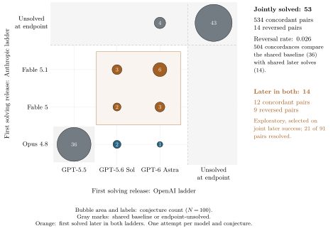
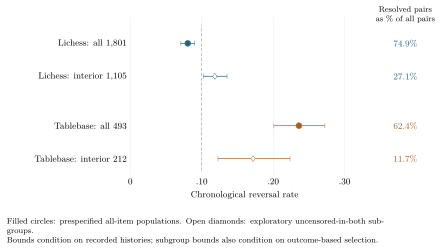
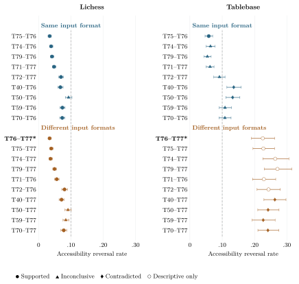

<!-- Port of the paper's LaTeX source, written by scripts/site_port.py
     in the paper's repository. Citations and the bibliography use the
     site pipeline; appendices use its aftermatter layout.
     See provenance.json for the source checksums. -->

## 1 Introduction {#sec:intro}

OpenAI and Anthropic have published separate papers reporting refutations of the Exponential Time Hypothesis [@openai2026theexponentialtime; @claude2026a2o]. Both accounts date a discovery milestone to October 16, 2026: a natural-language disproof in one and a core algorithm in the other [@openai2026buildingscientific; @claude2026a2o]. The matching dates are self-reports of different events, and we do not treat them as evidence. They raise a question that can be studied without them: why might models from different labs come to solve the same problems, and in what order?

We propose a *natural order hypothesis*: language models trained on substantially shared information, including its representation, tend to learn to solve problems reliably in approximately the same order. Training methods chiefly change the pace and extent of acquisition. The name borrows from second-language acquisition, where a similar distinction concerns the sequence of learning and its response to instruction [@krashen1982principlesandpractice].

We state the hypothesis in two forms (Section [2](#sec:hypothesis)). The weak form is the claim about order, and it is what we postulate. The strong form adds a single capability scale on which every model sits, so that comparable models succeed on the same problems at similar rates. We state it as a conjecture and expect it to fail when read exactly. In their exact versions, the strong form implies the weak, and the weak implies nested acquired sets. Approximate order constrains departures from nesting without excluding them. The three claims call for different observations: nesting can be seen in a single cross-section, order only by following acquisition through training, and a common scale only by comparing solve probabilities.

Shared learning orders already have precedents in neural-network research [@hacohen2020letsagreeto]; Liu et al. [@liu2026whatdolanguage] explicitly propose a predictable compositional order during language-model pretraining. The question here extends to open mathematical problems and the possible connection between acquisition order and discovery across labs.

The evidence reaches the three claims unevenly. On a bank of open conjectures, solved sets are often nearly nested across labs and across successive releases, with one substantially crossing model pair. On one chess bank, newly acquired problems show substantial descriptive agreement: pairwise concordance $\gamma$ is near $.76$ on resolved interior pairs. That subgroup is post hoc; it does not supply a confirmatory test of the weak form against within-recipe seed variation. The second chess bank contradicts the historical whole-bank order criterion across input formats. Fine acquisition order remains unobserved for language models, where release ladders are coarse and each verdict is a single attempt. The strong form has little support. A direct test requires repeated observations of abilities acquired during training, alongside the problems already solved or still beyond reach.

The two forms answer different parts of the opening question. The weak form says which problems come next for a lineage at a given stage. Only the strong form says how often a second lab's model succeeds where a first has, and neither says that two labs attempt a problem in the same week. We give one dated forecast of nested reach and propose tests that separate the forms (Section [8](#sec:predictions)).

## 2 The hypothesis {#sec:hypothesis}

A model may solve a problem occasionally before it can do so reliably. We propose that the order in which reliable solutions become possible transfers across model lineages.

We state the proposal in two forms. The weak form concerns that order alone and is the one we postulate. The strong form adds a single scale of capability and is offered as a conjecture. Unqualified, *natural order hypothesis* means the weak form.

::: {#weak-form .annotation .annotation--static}
**Natural order hypothesis (weak form).** Gradient-trained language-model lineages exposed to substantially shared informational inputs, including how those inputs are represented, acquire the ability to solve problems in an approximately common order. Within a specified domain and under fixed evaluation conditions, problems that become reliably solvable earlier in one lineage tend also to become reliably solvable earlier in others. Differences in training methodology chiefly affect the pace and extent of acquisition, with comparatively limited changes to its order. The hypothesis permits differences in success probability, acquisition speed, and the intervals between successive acquisitions.
:::

Training methodology means how training is conducted given the informational input and its representation. A test must define the eligible differences between learners before observing their order. Which architecture, size and optimization differences to include remains a design question (Section [8.1](#sec:pred-chains)). Commercial releases with opaque training inputs are observational comparisons; we call successive releases from one provider a *release ladder*, without assuming a documented training genealogy.

The weak form predicts that acquisition order transfers across eligible lineages. Similar aggregate performance alone does not require this: two models can solve equally many problems while acquiring different ones first.

### 2.1 What the terms commit to {#sec:terms}

Solve probability refers to repetitions of a fixed procedure: the model, problem statement, hints, agent scaffold, tools, compute budget, and solution-acceptance rule.

Let $p_{\ell i}(k)$ be the probability that lineage $\ell$, at checkpoint $k$, solves problem $i$ under the fixed evaluation conditions. For a fixed observation endpoint $T_\ell$, define *stable acquisition* at threshold $q=.5$ by $$\tau_{\ell i}(q;T_\ell)
 =
 \min\bigl\{k:
 p_{\ell i}(j)\geq q
 \text{ for every observed }j=k,\ldots,T_\ell\bigr\}.$$ This is the first observed checkpoint from which solve probability remains at or above the threshold through the observation endpoint. A problem reliably solvable throughout the window is already acquired when observations begin (*left-censored*). If its solve probability is below the threshold at the final checkpoint, no stable acquisition is observed within the window (*right-censored*), even if it was reliably solvable earlier. Two problems in the same boundary category cannot be ordered from these observations alone. Acquisition is relative to the chosen endpoint: extending the window can change it after a later loss.

To compare two lineages, we ask which problem in each pair was acquired first. Within a lineage, a pair is *ordered* when the observations place one acquisition before the other under a separation rule fixed before orders are compared. Two problems in the same boundary category remain unordered. In our release-ladder data, acquisitions at least one rung apart are ordered and same-release acquisitions are tied: on integer stages this is strict separation with zero tie tolerance. Chess chronology instead requires the earlier acquisition interval's upper endpoint to be strictly below the later interval's lower endpoint; touching intervals remain unordered (Appendix [C](#app:chess)). The separate chess accessibility comparison uses a minimum score separation, inclusive at its stated margin. A pair is *resolved* when it is ordered in both lineages. If one acquires X before Y and the other Y before X, this is a *reversal*. The reversal rate is the fraction of resolved pairs whose orders disagree. *Coverage* is the fraction of all problem pairs under study that are resolved. For example, if 40 of 100 pairs are resolved and four of those disagree, coverage is 40% and the reversal rate is 10%. This compares sequences without requiring the lineages to share a training clock.

A reversal rate $r$ gives the pairwise concordance coefficient $\gamma=(C-R)/(C+R)=1-2r$ on the resolved pairs, where $C$ and $R$ count concordances and reversals. This is not an unqualified rank correlation over all items: tied and unresolved pairs are omitted. Independent unrelated orders give expected $r=.5$ and $\gamma=0$ under symmetric resolution; $r=.1$ gives $\gamma=.8$.

*Approximately* has a meaning only against two references. One is the reversal rate between unrelated orders, $.5$. The other is the rate between two runs of a single training recipe that differ only in random seed, which no comparison of methods can be expected to beat. The weak form asserts that reversal rates between eligible lineages, among pairs resolved at the stated margin and with adequate coverage, lie near the second reference and far from the first. Neither of our data sets supplies the seed reference; the direct test in Section [8.1](#sec:pred-chains) requires it.

Agreement must also be measured among acquisitions observed inside both windows, since boundary comparisons can agree without any new acquisition. We call a resolved pair *interior* when both of its problems are acquired inside the observation window in both lineages, and a *boundary* pair otherwise. Single-attempt records provide proxies for acquisition; estimating the underlying probabilities requires repeated attempts and uncertainty treatment (Section [8.1](#sec:pred-chains)).

### 2.2 What the weak form implies for solved sets {#sec:nested-reach}

On a common problem universe, write $A_\ell(k)=\{i:\tau_{\ell i}\leq k\}$ for the set of problems that lineage $\ell$ has acquired by checkpoint $k$, with $\tau_{\ell i}=+\infty$ when no stable acquisition is observed. At the endpoint, $A_\ell(T_\ell)$ is the set of problems reliably solvable there.

::: {#prop:nested .annotation .annotation--static}
**Proposition 1 (Nested reach).** *For two lineages $\ell$ and $\ell'$ and any checkpoints $k$ and $k'$, the number of pairs reversed at margin zero is at least $$\bigl|A_\ell(k)\setminus A_{\ell'}(k')\bigr|\cdot\bigl|A_{\ell'}(k')\setminus A_\ell(k)\bigr|.$$ In particular, if the two lineages have no reversals, one of $A_\ell(k)$ and $A_{\ell'}(k')$ contains the other.*
:::

::: proof
[Proof.]{.proof-label} Take $i$ in $A_\ell(k)$ but not in $A_{\ell'}(k')$, and $j$ in $A_{\ell'}(k')$ but not in $A_\ell(k)$. In $\ell$, problem $i$ is acquired by checkpoint $k$ and problem $j$ is not, so $i$ precedes $j$; this holds whether $i$ is left-censored, $j$ is right-censored, or neither. In $\ell'$, by the same argument, $j$ precedes $i$. Every such pair is therefore a reversal, and there are as many of them as the product. Without reversals, one of the two differences is empty. [□]{.proof-qed}
:::

This is a statement about acquired sets and strict acquisition order, not noisy single-attempt solved sets. If $M$ pairs are resolved at margin zero and $R=rM$ reverse, the product of the two set differences is at most $rM$. Zero reversals force exact nesting; a small reversal rate permits crossing sets. With a positive separation requirement, the bound applies only to cross-difference pairs meeting that requirement in both lineages.

Exact nesting is therefore the cross-sectional signature of an exact common acquisition order. The approximate weak form instead constrains the extent of crossing through Proposition [1](#prop:nested); it does not require exact inclusion. Near-nesting can be examined in a single cross-section, or along a release ladder with few rungs, and falls well short of establishing acquisition order. Nested sets order only the pairs that some observed cut separates. Two problems that both lineages acquire between the same consecutive observations are left unordered by nesting, and their order is what the weak form adds. Single-attempt solved sets are proxies for acquired sets, so observed nesting supports this consequence only to the extent that single verdicts track reliable solving.

### 2.3 The strong form: a shared capability scale {#sec:shared-scale}

The strong form makes two additions. On the item side, problems keep one order by solve probability in every lineage and at every checkpoint, and not only at the moment each crosses a threshold. On the model side, models are themselves ordered: a single coordinate places every checkpoint of every lineage, and two models at the same position succeed on each problem at the same rate. We expect this form to fail when read exactly. We state it because it is the form that would connect a common order to how often discoveries repeat.

::: {#strong-form .annotation .annotation--static}
**Natural order hypothesis (strong form).** Problem-solving performance in gradient-trained language models exposed to substantially shared informational inputs, including how those inputs are represented, is approximately governed by a common capability scale. Within a specified domain and under fixed evaluation conditions, a model's position on that scale and a problem's accessibility jointly determine the probability that the model solves the problem through a common function increasing in both arguments. Differences between lineages and training methodologies chiefly affect models' positions on the scale. Models at comparable positions consequently exhibit approximately similar solve probabilities on individual problems.
:::

An exact version makes the relationship explicit: $$p_{\ell i}(k)=F\bigl(c_\ell(k),a_i\bigr).$$ Here $c_\ell(k)$ is the lineage's capability at checkpoint $k$, and $a_i$ is the accessibility of problem $i$. The same function $F$ applies to every lineage and problem. Increasing capability raises solve probability for a given problem; increasing accessibility raises it for a model at a given capability. The item side is the monotonicity of $F$ in accessibility. The model side is that capability is a single number and $F$ is shared, so that models at the same position on the scale have the same solve probability on each problem.

The item side imposes a common ordering of problems by solve probability. If $a_i\geq a_j$, then in every lineage and at every checkpoint, $$p_{\ell i}(k)\geq p_{\ell j}(k).$$ Problem $i$ remains at least as likely to be solved as problem $j$ throughout training. In psychometrics, *invariant item ordering* means that test items retain the same ordering by probability of a correct response across ability levels: item response functions do not cross as latent ability varies [@sijtsma1996invariantitemordering p. 83]. The exact strong form imposes this property across model lineages through the shared function $F$.

::: {#prop:strong-weak .annotation .annotation--static}
**Proposition 2 (The strong form implies the weak).** *Suppose the item side of the exact strong form holds: there are accessibilities $a_i$ such that $a_i\geq a_j$ implies $p_{\ell i}(k)\geq p_{\ell j}(k)$ in every lineage and at every checkpoint. Then no pair of problems is reversed between any two lineages, at any threshold $q$, or between two different thresholds.*
:::

::: proof
[Proof.]{.proof-label} Fix a lineage, an endpoint and a threshold, and let $a_i\geq a_j$. Suppose problem $j$ stays at or above the threshold from some checkpoint through the observation endpoint. Problem $i$, whose solve probability is at least as high at every checkpoint, meets the threshold throughout the same period, so its stable acquisition occurs no later: $\tau_{\ell i}\leq\tau_{\ell j}$. Now suppose $i$ strictly precedes $j$ in some lineage at some threshold. Then $a_j\geq a_i$ is impossible, so $a_i>a_j$, and in every lineage and at every threshold $i$ is acquired no later than $j$. [□]{.proof-qed}
:::

The argument uses only the item side, and it holds even if capability fluctuates during training, since it compares the two probabilities checkpoint by checkpoint. Together with Proposition [1](#prop:nested) it gives the exact hierarchy: nested reach, common acquisition order, and a shared capability scale, each implied by the next. The approximate forms retain this hierarchy as a guide to evidence, but departures must be assessed against their stated tolerances; any crossing alone does not refute the approximate weak form.

The converse of Proposition [2](#prop:strong-weak) fails. The weak form allows two lineages to acquire X before Y and later become more reliable on Y; the exact strong form excludes that change in probability order. The weak form is stated at one threshold, and the order of crossing at $.5$ need not be the order at $.25$ or $.75$. And the weak form does not ask that models with equal overall performance have equal probabilities on each problem.

Proposition [2](#prop:strong-weak) relates the exact forms. An approximately common scale does not by itself bound the reversal rate: where many problems have nearly equal accessibility, small departures in probability reorder their threshold crossings. This is why the weak form is stated with a margin, so that pairs the measurement cannot separate are unresolved and are counted neither as agreements nor as reversals. Testing an approximate strong form still requires a measure and tolerance for departures from the common scale, both of which remain open. A particular parametric model can also impose more than the strong form. The Rasch model specifies an additive logistic $F$, so rejecting it does not reject the strong form, and failing to reject it does not establish a common scale (Section [5.1](#sec:open-problems)).

### 2.4 What separates the forms {#sec:forms}

Table [1](#tab:forms) sets out which observations bear on which claim. Three of them are compatible with the weak form and count against the strong: an acquisition order that changes with the threshold, a probability order that reverses after both problems are acquired, and models matched on overall performance that differ on individual problems.

::: {#tab:forms}

| Observation | Nested reach | Weak form | Strong form |
| --- | --- | --- | --- |
| Solved sets nest; interior order unobserved | Supports | Necessary only | Necessary only |
| Reliably solved sets cross | Against exact nesting | Constrained by Proposition [1](#prop:nested) | Against exact form |
| Interior pairs reverse well beyond the seed reference | Compatible | Against | Against |
| Interior order agrees to near the seed reference | Supports | Supports | Necessary only |
| Acquisition order changes with the threshold | Compatible | Compatible | Against |
| Probability order reverses after both problems are acquired | Compatible | Compatible | Against |
| Models matched on total score differ on individual problems, while reliably solved sets still nest | Compatible | Compatible | Against |
| Matched models have matched probabilities on each problem | Silent | Silent | Supports |

: Table 1: Observations and the claims they bear on. The implications are exact for exact versions of the claims. For approximate forms, crossings and reversals must be assessed against specified tolerances and measurement uncertainty.

:::

The forms also differ in what they say about discoveries made twice. The weak form says which problems come next. Two lineages at nearby stages face the same frontier, and if both attempt it they attempt problems of similar standing. It does not say that two lineages are at nearby stages, since it permits any difference in pace, and it does not say how often a second attempt succeeds. Aligned acquisition at $.5$ gives two independent single attempts a joint success probability of $.25$.

The model side of the strong form supplies the missing quantity. For conditionally independent attempts by matched models with common item-specific probability $p$, averaging over a specified population of problems gives $$\Pr(Y_B=1\mid Y_A=1)=\frac{\mathbb E[p^2]}{\mathbb E[p]}
 =\mathbb E[p]+\frac{\operatorname{Var}(p)}{\mathbb E[p]}.$$ Replication is frequent when accessibility is polarized, with most problems either well within reach or well beyond it, and rare when success is uniformly unlikely: if every eligible item has $p=.01$, the rate is $.01$. The strong form supplies no universal replication rate. A numerical forecast needs a specified population and its own empirical justification.

A double on the same day therefore asks for more than either form. The lineages must be at nearby stages, both must attempt the problem at nearby times, and the problem must lie where both succeed often.

### 2.5 An order and its possible explanations {#sec:order-explanation}

One possible explanation of the weak form is that accessibility reflects a problem's relation to training information: shared inputs would produce similar orders, while differences in relevant information would move particular problems. On this account the hypothesis says more than that some problems are harder than others. The order should survive a change of training method, and it should move when the information or its representation changes. An account based on problem structure alone predicts the first and not the second.

The shortest sufficient hint could measure a problem's relation to training information, provided missing knowledge can be distinguished from elicitation, since short opening cues can substantially change mathematical performance [@zhang2026whatrlbrings; @wang2026basemodelscan]. The proposed ETH hint study would examine assistance for one theorem and route. Other explanations include problem structure, common training practices, contamination and convergent representations [@huh2024theplatonicrepresentation]; Section [7](#sec:rivals) considers how to distinguish them.

## 3 Background {#sec:background}

### 3.1 Orders already observed in neural learning {#sec:nn-order}

A common order in neural learning has direct precedents. Hacohen et al. [@hacohen2020letsagreeto] report similar orders of example learning across neural-network architectures in the settings they study, while also constructing cases in which agreement fails. Choshen et al. [@choshen2022thegrammarlearning] investigate grammatical development across language models, and Chen et al. [@chen2023skillitadata] discuss a natural order of skills in data selection. Shared learning order is therefore an existing empirical question. The present proposal concerns its extension to reliable problem solving, particularly open problems, and the evidence needed to connect an acquisition order to multiple discovery.

The Implicit Curriculum Hypothesis of Liu et al. [@liu2026whatdolanguage] is an especially close predecessor: it concerns the order in which constructed tasks emerge during language-model pretraining. Their cross-model agreement is appreciably higher under fixed performance thresholds than relative thresholds. The corpora share sources, including in the Amber and Crystal models released through LLM360 [@liu2023llm360towardsfully]. Both the overlap in inputs and the sensitivity to the acquisition criterion bear directly on the present tests.

Structured learning dynamics [@saxe2019amathematicaltheory; @nakkiran2019sgdonneural], word acquisition [@chang2022wordacquisitionin], and mathematical skill development [@mishra2025fromnexttokento] offer further precedents. Representational alignment [@li2016convergentlearningdo; @huh2024theplatonicrepresentation] and correlated errors [@goel2025greatmodelsthink; @kim2025correlatederrorsin] concern related forms of agreement at an endpoint.

### 3.2 A natural order in second-language acquisition {#sec:sla}

Krashen's natural order hypothesis proposes a predictable sequence of grammatical acquisition [@krashen1982principlesandpractice], while work on processability and instruction distinguishes the pace of learning from its route [@bettoni2015grammaticaldevelopmentin]. Evidence also points to the learner's background: Murakami and Alexopoulou [@murakami2016l1influenceon] find stronger agreement within than between seven first-language groups, and earlier case evidence complicates accounts based on frequency [@hakuta1976acasestudy]. Goldschneider and DeKeyser [@goldschneider2001explainingthenatural] use oral-production accuracy as a proxy for acquisition order, relating scores for six grammatical forms across twelve studies to five linguistic and input-related predictors. However, Murakami [@murakami2014individualvariationand] questions the small number of morphemes relative to predictors and obtains a similar fit with unrelated predictors. Apparent orders also depend on item selection, the acquisition criterion, and whether individual trajectories or group averages are compared [@pallotti2008acquisitionsequencesand].

### 3.3 Multiple discovery {#sec:multiples}

Multiple discovery has long been connected to shared intellectual and material conditions. Ogburn and Thomas [@ogburn1922areinventionsinevitable] emphasize prerequisites and recognition of a worthwhile problem.

Simonton [@simonton1978independentdiscoveryin] fits Poisson models to historical counts of multiples, arguing that repeated discovery need not imply inevitability. Brannigan and Wanner [@brannigan1983historicaldistributionsof] question the equivalence and independence of recorded discoveries and propose a communication model in which announcing a result discourages duplication. Simonton [@simonton1986multiplediscoverysome] produces similar distributions of multiplicity under different assumptions about communication and success, and explains how probabilistic discovery can accommodate prerequisites that constrain the order.

A catalog of celebrated doubles omits unsuccessful and unattempted problems. Human discovery races also involve selective effort, as in structural biology [@hill2025scoopedestimatingrewards]. A fixed machine evaluation can assign every model every problem and retain failures. Independent allocation then predicts overlap $ab/M$ when two systems solve $a$ and $b$ of $M$ problems; shared difficulty can raise that overlap.

Historical accounts also distinguish targets from results, and full from partial contributions [@lynch2025discoveryanddiscovering; @whitty2017somecommentson]; peer judgment and reception enter the identification of a discovery [@merton1988themattheweffect].

### 3.4 Shared outcomes, routes, and information {#sec:vocabulary}

Evolutionary biology separates a shared outcome from a shared route. Shared ancestry, repeated use of related mechanisms, and different mechanisms under similar constraints are distinct [@woods2006testsofparallel; @stayton2015whatdoesconvergent], and replay experiments separate common outcomes from common sequences [@blount2008historicalcontingencyand; @blount2018contingencyanddeterminism]. The grain of comparison matters [@orgogozo2015replayingthetape], as does the difficulty of reconstructing history from endpoints [@losos2020revisitinglososet]. We accordingly compare the ETH papers at the levels of target, theorem, framework, and mathematical engine (Appendix [A](#app:ledger)).

[]{#sec:networks label="sec:networks"} Connected learners also exchange information and methods, which can correlate both what agents know and what they investigate [@zollman2007thecommunicationstructure; @weisberg2009epistemiclandscapesand].

## 4 Machine multiples: the motivating observation {#sec:observation}

Different labs have reported machine solutions to the same open problems in nearby periods. The claimed refutations of the Exponential Time Hypothesis (ETH) are the most closely documented pair, and they prompted this paper. They are motivation only: nothing in this section enters the assessment of either form.

Both labs date a discovery milestone to October 16, 2026 (Table [2](#tab:timeline)). The dates are self-reports of different events, a natural-language disproof and a core algorithm, and we did not locate either lab's original artifacts in the public record checked through November 9. The released papers state counting algorithms with the same dependence on the number of variables in their sharp time bounds, and they share a framework for reaching those bounds. They differ in their recursions, parameter dependence, space claims and formalized scope. Appendix [A](#app:ledger) gives the comparison level by level, with three further candidate doubles and a case in which a rumor redirected effort.

::: {#tab:timeline}

|  | OpenAI | Anthropic |
| --- | --- | --- |
| Reported milestone | Natural-language disproof, October 16; formalization, October 17 | Core algorithm, October 16 |
| Date on the paper | October 17, revised October 25; the October 17 text is not public | October 26 |
| Release commit (UTC$-$7) | October 26, 13:35 | October 26, 19:45 |
| Citation of the other | None in the version inspected | Cites OpenAI's preprint |

: Table 2: Reported and recorded dates for the two claimed ETH refutations, all in 2026. Milestones are self-reports with no stated common time zone. Commit times are those recorded in the two repositories and do not establish first public availability [@openai2026buildingscientific; @claude2026a2o; @openai2026mathrepo; @anthropic2026formalmath].

:::

Three features keep the double out of the evidence. It was selected on its outcome: it drew attention because the dates matched. The public releases were not independent events, since Anthropic's release commit follows OpenAI's by about six hours and its paper cites OpenAI's preprint; this dates an opportunity to revise and says nothing about October 16. And a double on the same day asks more than the weak form supplies (Section [2.4](#sec:forms)): the two lineages must have been at nearby stages, both must have attempted the problem at nearby times, and the problem must have come within reach of both recently, when it might instead have been reachable for some time and only then attempted. Section [7](#sec:rivals) takes up those alternatives.

## 5 Evidence from language models {#sec:lm-evidence}

Released OEIS Open evaluations allow a comparison of models attempting the same open problems under a common procedure. Their solved sets are nearly nested across labs and short release ladders. This is strong evidence for nested reach, the consequence of the weak form that a cross-section can show (Proposition [1](#prop:nested)). Agreement about the order of newly observed solves, which is what the weak form adds, is less well established, and the strong form has little support.

### 5.1 Shared reach and order on open problems {#sec:open-problems}

OEIS Open contains 492 conjectures on 444 integer sequences, with a random subset of 100 forming Lite [@adamczewski2026oeisopenhow]. Our account of their selection and formalization in Tsoukalas et al. [@tsoukalas2026advancingmathematicsresearch] follows Adamczewski. Evaluations use a common networkless agent with Lean and mathematical tools, at \$50 per conjecture on the full set and \$200 on Lite. We analyzed upstream commit `fd09021e` under a plan committed before per-conjecture verdicts were opened (Appendix [B](#app:plans)). The plan's order gate required a one-sided 97.5% upper bound on the reversal rate of at most $.10$ and a lower bound on coverage of at least $.20$. A comparison meeting both is *supported*; one whose lower reversal bound exceeds $.10$ is *contradicted*; any other is *inconclusive*.

**Nested reach.** The plan's primary analysis measures shared reach on the full set: overlap between solved sets beyond what a baseline predicts. Nesting is the particular form of overlap that Proposition [1](#prop:nested) requires. Its three models---Opus 4.8, GPT-5.5, and Gemini 3.5 Flash---share the original verifier and evaluation setting. They solve 147, 129, and 109 conjectures, respectively. All 109 Flash solves occur among the Opus solves, as do 126 of GPT-5.5's 129. Across these models and the additional Gemini 3.1 Pro run, 342 conjectures are solved by none, 90 by all four, and 21 by exactly one. Of the six pairs among these four models, two are exactly nested and three have at most three conjectures on the smaller side. The exception is Gemini 3.5 Flash against Gemini 3.1 Pro, the run with a different verifier: each solves conjectures the other misses, 17 and 14.

Table [3](#tab:open-problems) compares overlap with two baselines. All three primary pairs exceed independent allocation at fixed solved counts after Holm adjustment. The second baseline predicts verdicts from statement and description length, proposal year, proposer, selected words, and conjectures per sequence. Adding another model's verdict improves held-out log loss by .47--.55 bits per conjecture across six directions, with all intervals above zero. Folds and resampling are grouped by OEIS sequence.

<table>
<caption>

Table 3: Overlap on OEIS Open at \$50, base agent, 492 conjectures. $\Delta$ is in bits per conjecture, for the first model given the second and the reverse.

</caption>
<thead>
<tr>
<th scope="col">

Pair (solved by each)

</th>
<th scope="col">

Overlap, expected

</th>
<th scope="col">

Lift

</th>
<th scope="col">

$p$ (Holm)

</th>
<th scope="col">

$\Delta$

</th>
<th scope="col">

$\Delta$, reverse

</th>
</tr>
</thead>
<tbody>
<tr>
<td>

Opus 4.8 -- GPT-5.5 (147, 129)

</td>
<td>

126, 38.5

</td>
<td>

3.27

</td>
<td>

$<10^{-4}$

</td>
<td>

.544 (.461, .628)

</td>
<td>

.553 (.470, .637)

</td>
</tr>
<tr>
<td>

Opus 4.8 -- Gemini 3.5 Flash (147, 109)

</td>
<td>

109, 32.6

</td>
<td>

3.35

</td>
<td>

$<10^{-4}$

</td>
<td>

.475 (.397, .555)

</td>
<td>

.479 (.397, .566)

</td>
</tr>
<tr>
<td>

GPT-5.5 -- Gemini 3.5 Flash (129, 109)

</td>
<td>

107, 28.6

</td>
<td>

3.74

</td>
<td>

$<10^{-4}$

</td>
<td>

.527 (.449, .610)

</td>
<td>

.527 (.449, .611)

</td>
</tr>
<tr>
<td colspan="6">

Without 21 statements marked flawed (post hoc, $n = 471$):

</td>
</tr>
<tr>
<td>

Opus 4.8 -- GPT-5.5 (126, 108)

</td>
<td>

105, 28.9

</td>
<td>

3.63

</td>
<td>

</td>
<td>

.496 (.404, .581)

</td>
<td>

.500 (.408, .586)

</td>
</tr>
<tr>
<td>

Opus 4.8 -- Gemini 3.5 Flash (126, 88)

</td>
<td>

88, 23.5

</td>
<td>

3.74

</td>
<td>

</td>
<td>

.423 (.339, .508)

</td>
<td>

.422 (.337, .502)

</td>
</tr>
<tr>
<td>

GPT-5.5 -- Gemini 3.5 Flash (108, 88)

</td>
<td>

86, 20.2

</td>
<td>

4.26

</td>
<td>

</td>
<td>

.467 (.380, .550)

</td>
<td>

.463 (.378, .548)

</td>
</tr>
<tr>
<td colspan="6">

Two release ladders on Lite ($n = 100$), 97.5% bounds: reversal .005 (.000, .013), coverage .606 (.556, .650); with stages permuted, .500 and .416.

</td>
</tr>
</tbody>
</table>

The overlap thus exceeds what the *prespecified metadata* predict. Those features are not a measurement of mathematical difficulty, which could carry the additional predictive information. Independent allocation is also a weak baseline when problems differ in difficulty. Assigning every model the same list controls target choice within the evaluation; selection of the bank and prior exposure remain possible sources of agreement.

Changing the agent changes one to six of a model's 100 Lite verdicts. Cross-lab differences under a fixed agent range from two to twelve; Opus--GPT-5.5 differs on two to four. Without repetitions, scaffold effects and sampling variation are confounded. Stratifying overlap by how many of the other two full-set models solved each problem gives an odds ratio of 38 for Opus--GPT-5.5 and 3.44 for Flash--Pro, with interval 1.00--10.32 for the latter. Most other intervals are unestimable, and Pro uses a different verifier.

A post hoc audit of accepted proof summaries by the author, without inspecting Lean developments, marked 21 statements as flawed and seven as suspect, all solved by at least three models. Some of the shared reach is therefore shared success on flawed statements. Removing the 21 leaves the overlap and prespecified ordering results unchanged; it does not resolve the distinction between reach and interior acquisition. Solve-cost rank correlations among jointly solved items remain .78--.89.

**Order among new solves.** The ordering comparison uses two three-release ladders on Lite: Claude Opus 4.8, Fable 5, and Fable 5.1; and GPT-5.5, GPT-5.6 Sol, and GPT-6 Astra. Figure [1](#fig:oeis-order) shows the first observed solves. The prespecified analysis assigns each conjecture its first solving rung, censoring those unsolved above the ladder. Solved sets are perfectly nested within each ladder. Across ladders, 2,985 pairs are concordant and 14 reversed: reversal .005, with bounds .000--.013, and coverage .606, with bounds .556--.650. These one-sided 97.5% bounds pass the gate.

<figure id="fig:oeis-order">

<figcaption>

Figure 1: First observed solves on OEIS Open Lite at \$200 per conjecture. Bubble areas and labels give conjecture counts; blank cells are zero. Gray bands retain conjectures unsolved at a ladder's endpoint. The jointly solved comparison is post hoc and dominated by baseline-to-later comparisons; Table [4](#tab:oeis-decomposition) separates these from order among new solves. Each release--conjecture verdict comes from one attempt.

</figcaption>
</figure>

The gate could not tell nested reach from interior order. Of the 2,985 concordances, 2,451 involve a conjecture unsolved in one or both ladders. A post hoc comparison restricted to the 53 problems solved in both ladders gives 534 concordant pairs and 14 reversals, a reversal rate of .026, and 504 of those concordances compare the 36 problems both initial releases already solve with the 14 both later solve. The passing result is therefore evidence for nested reach, and it is nearly silent on the order that the weak form adds.

A post hoc decomposition makes the distinction explicit (Table [4](#tab:oeis-decomposition)). Among the 61 conjectures both initial releases miss, later Anthropic releases solve 14 and later OpenAI releases solve 18, with all 14 shared; independent allocation at those margins predicts overlap of 4.13. Keeping all 61 gives 634 concordances and nine reversals, again including unresolved-at-endpoint problems. Among only the 14 later solved by both, there are 12 concordances and nine reversals: reversal .429 and coverage $21/91=.231$. Removing only the joint baseline group from the 53 jointly solved problems leaves 17 problems, 30 concordances and 14 reversals.

::: {#tab:oeis-decomposition}

| Population | $n$ | Concordant | Reversed | Rev. | Cov. |
| --- | --- | --- | --- | --- | --- |
| All problems (prespecified test) | 100 | 2,985 | 14 | 0.5 | 60.6 |
| Solved in both ladders | 53 | 534 | 14 | 2.6 | 39.8 |
| Previous row, excluding joint baseline | 17 | 30 | 14 | 31.8 | 32.4 |
| Missed by both initial releases | 61 | 634 | 9 | 1.4 | 35.1 |
| Previous row, later solved by both | 14 | 12 | 9 | 42.9 | 23.1 |

: Table 4: OEIS Lite order decomposed by observation window. Rungs are first observed solves, with one attempt per release--problem cell. The first row reproduces the prespecified all-item count; the cohort decompositions are post hoc. Reversal and coverage are percentages, without new confidence intervals.

Coverage uses all unordered pairs within each row's population. Endpoint-selected rows condition on observed success; their pair counts are dependent and do not supply new confirmatory rejection tests. Of the 534 concordances in the jointly solved population, $36\times14=504$ compare joint baseline solves with joint later solves.

:::

The shared reach of later releases is clearer than the order of their new solves. Because the restricted cohorts were selected after observing outcomes, including endpoint success, their dependent pair counts diagnose the aggregate agreement rather than supply independent confirmatory evidence: the 14-problem result, with $\gamma=.14$ on 21 resolved pairs, neither provides a well-powered rejection of the weak form nor supports a common fine order. The acquisition interpretation is limited further by single-attempt verdicts on three-rung ladders with a different verifier at the top. With no recorded losses, first and stable crossings coincide in these binary observations, but they do not identify acquisition at probability .5, nor does public release order establish a shared training genealogy, corpus or representation.

**The strong form.** A post hoc scale check uses the 29 Lite items distinguishing the nine models. On 22, the solvers are exactly the strongest models ranked by total solves; Loevinger's $H$, which is 1 for perfectly nested patterns, is .87 on the 29 discriminating items (.99 on all 100). On the full set with four models, $H$ is .18 on the 60 discriminating items (.95 on all 492). The populations, model ranges and budgets differ, so these values are not a controlled contrast; retaining the universally solved and universally unsolved items greatly raises both all-item summaries. Of the 22 Guttman errors on the full set, 14 come from the Flash--Pro pair noted above, so the low value mixes scale misfit with a difference of verifier.

The verdict matrices are compatible with a conditional Rasch null that fixes model and item margins. This null assumes independent responses with $p_{mi}=\operatorname{logistic}(\theta_m-b_i)$, a narrower structure than the general increasing function of the strong form. Its rejection could reflect Rasch misfit or dependence without rejecting the strong form; nonrejection does not identify a common scale. In the 10,000 saved Lite null draws, 30 of 36 model-pair co-solve 95% intervals have identical endpoints. The synthetic controls establish neither power at these margins nor equivalence to the null. The result supplies little affirmative evidence for the strong form.

**The bank.** A Gemini model selected the source conjectures and an agent formalized them. Adamczewski reports that 37% were proposed by Zhi-Wei Sun and 47% have no OEIS links or references. These figures show concentrated authorship and limited linked literature, but they do not directly measure mathematical difficulty, prior exposure, nor research attention. Equal dollar budgets also leave differences in tokens and inference procedures.

### 5.2 Reachability under changes of method {#sec:lm-for}

Studies on known-answer mathematics suggest that post-training changes how readily models reach solutions already available under more extensive sampling. Yue et al. [@yue2025doesreinforcementlearning] compare base and reinforcement-trained models at large sample budgets. On AIME24 with 1,024 samples per problem, 63.3% of problems are solved by both, 13.3% by the base alone, and none by the reinforcement-trained model alone. On MATH500 with 128 samples, the corresponding proportions are 92.4%, 3.6%, and 1.0%. Comparisons across six reinforcement-learning algorithms show relatively little variation in their reported sampling-efficiency measure. Short opening cues can also change reliability: prefilling a cue found in training can recover substantial mathematical performance from a base model, and a controlled data intervention changes which cue elicits it [@wang2026basemodelscan].

Nesting also appears in published within-lab comparisons on open problems: the novel solutions of GPT-5.4 Pro are included among those of GPT-5.6 Sol Max [@wang2026measuringprogressin]. In the OEIS Open report, 35 of Fable 5's 44 Lite solves were also solved by Opus 4.8 on the full set at a quarter of the budget [@adamczewski2026oeisopenhow]. First Proof systems sharing a base model passed largely the same research-level problems, although those problems had known answers and the comparison had one run per cell [@abouzaid2026firstproofsecond]. In comparisons across families, development stage can matter as much as lineage: in our calculations from Liu et al. [@liu2026whatdolanguage], cross-family order correlations for models near in size exceed those of some same-family pairs far apart in size. Similarity peaking near matched performance also appears in Choshen et al. [@choshen2022thegrammarlearning]. With corpus and tokenizer fixed, Michaelov et al. [@michaelov2025languagemodelbehavioral] report word-prediction correlations of at least .93 across Pythia, Mamba, and RWKV.

### 5.3 Variation that a common order must accommodate {#sec:lm-against}

OLMo 2's mid-training stage raises GSM8K accuracy from 24.1 to 67.5 while MMLU moves from 59.8 to 63.7 [@olmo20252olmo2]. It changes the data mixture and includes GSM8K training examples. Increasing code content likewise affects code and natural-language tasks differently [@aryabumi2024tocodeor; @liu2026notjustscaling]. Suppressing syntactic attention structure in BERT changes the appearance of later capabilities [@chen2023suddendropsin], while instruction tuning and post-training have different effects across skill factors, mathematical skills, and pretraining durations [@burnell2023revealingthestructure; @mishra2025fromnexttokento; @springer2025overtrainedlanguagemodels]. Even within a fixed recipe, inter-seed agreement in PolyPythias settles near $\kappa=.5$ [@vanderwal2025polypythiasstabilityand]; word and grammatical development also vary across seeds [@chang2024characterizinglearningcurves; @evanson2023languageacquisitiondo]. Among 100 BERT seeds with similar development-set accuracy, McCoy et al. [@mccoy2020bertsofa] find a much larger spread out of distribution. These aggregate and skill-level findings motivate item-level comparisons, with seed variation as a necessary reference for assessing method differences.

The abstract of Lee et al. [@lee2026differentialitemfunctioning] reports differential item functioning between Llama and Qwen after conditioning on total score. Smaller models also outperform larger ones on some BIG-Bench tasks [@wei2022emergentabilities]. Such departures count against the strong form; their bearing on the weak form depends on whether they reorder acquisitions. They coexist with broader regularities: Kipnis et al. [@kipnis2025metabenchasparse] report a dominant ability factor, while item-response models predict mathematical benchmark outcomes well in Castleman et al. [@castleman2025rethinkingmathbenchmarks]. Measurement choices, including exact-match scoring and target length, can themselves produce apparently sharp transitions [@schaeffer2023areemergentabilities].

### 5.4 What might produce the agreement {#sec:lm-source}

Existing designs separate several sources of agreement: seed studies hold a recipe fixed; Michaelov et al. [@michaelov2025languagemodelbehavioral] compare architectures under shared corpus and tokenizer; Magnusson et al. [@magnusson2025datadecidehowto] vary data mixtures; and post-training studies compare objectives within a base-model family. Word acquisition tracks input statistics [@chang2022wordacquisitionin], while example-learning agreement depends on learner family [@hacohen2020letsagreeto].

In document search, models agree more with one another than with people at matched accuracy [@borchmann2026strategicnavigationor]. First Proof's referees also describe better performance on problems resembling known results [@abouzaid2026firstproofsecond]. These observations suggest corpus proximity as one contributor to machine accessibility.

### 5.5 How far training inputs are shared {#sec:corpora}

The public training-data summaries name Common Crawl for GPT-6 Astra and Claude Opus 5.5 [@openai2026publicsummaryof; @anthropic2026publicsummaryof]; Gemini 3 Pro's names no particular third-party web corpus [@google2026publicsummaryof]. These disclosures identify sources rather than example-level overlap.

Baack documents common web sources in GPT-3 and released models [@baack2024acriticalanalysis; @baack2024trainingdatafor]; Longpre et al. [@longpre2024consentincrisis] examine source-domain overlap. Filtering, partner and user data, and synthetic material introduce further variation. Synthetic data also connects families: OLMo 2's mathematical mixture includes GPT-4o and Qwen2.5 outputs [@olmo20252olmo2].

### 5.6 Tests the available data permit {#sec:further-tests}

Table [5](#tab:datasets) lists data for further comparisons. OLMo variants could test whether changing the objective changes acquisition order beyond seed variation; DataDecide could compare corpus and seed effects. The prospective chain test in Section [8.1](#sec:pred-chains) follows acquisition on a fixed bank with repeated attempts.

::: {#tab:datasets}

| Release | License | Possible comparison |
| --- | --- | --- |
| LeanOpenProblems-results | none declared | Per-conjecture overlap across labs at equal budget; nesting across generations |
| DataDecide eval instances | ODC-BY | Is item order more sensitive to corpus than to seed? 25 corpora, fixed recipe; cloze, little math |
| MathCAMPS responses | MIT | Rank agreement over items across labs against a difficulty null; K--8 |
| OLMo 3 and OLMo 2 variants | Apache-2.0, ODC-BY | With pretraining fixed, does a change of mix or objective reorder items? Needs a small inference run |
| ElementalTask results | MIT | Rerun Liu et al.'s second hypothesis against a difficulty-only null; four models only |
| MMLU-Pro eval results | Apache-2.0 | Post-training contrast on items; multiple choice |
| Open LLM Leaderboard details | unstated | Differential item functioning with real power; many derivatives |
| PolyPythias | Apache-2.0 | The seed floor for an item order at 410M; no item outputs |
| LLM360 | Apache-2.0 | Order at matched StarCoder exposure |

: Table 5: Candidate data for further language-model comparisons. Licenses describe the recorded releases and require confirmation before reuse. Only the OEIS analysis was performed here.

:::

## 6 A verifiable precedent: chess {#sec:chess}

Chess permits repeated evaluation across many training checkpoints at modest cost. We measure shared accessibility and acquisition order on first-move decisions from historical self-play runs. Their ancestry and data independence are unestablished. Self-play runs generate their own training data, so chess cannot test the clause on shared information: agreement here speaks to problem structure and learner family at least as much as to a common corpus. What these comparisons provide is a provisional precedent for the weak form, a test of whether an acquisition order transfers at all, at a resolution the language-model data lack.

### 6.1 Existing evidence {#sec:chess-known}

On Lichess, Zahavy et al. [@zahavy2023diversifyingaitowards] report about 84.94% solved by one AlphaZero seed and 93.10% by the union of three, read from their figure. Shared failures exceed the expectation under homogeneous, independent failures, as a shared difficulty scale would predict. Starting self-play from puzzle positions also changes performance substantially. Other endpoint comparisons examine learned piece values [@tomasev2020assessinggamebalance; @palsson2023unveilingconceptslearned], agreement with human moves [@silver2017masteringthegame; @mcilroyyoung2020aligningsuperhumanai], shared blind spots [@wang2022adversarialpoliciesbeat], or the prediction of human difficulty [@bjorkqvist2025estimatingthedifficulty].

Published developmental studies examine the acquisition of a small set of chess concepts [@mcgrath2022acquisitionofchess], while work on Hex and Go shows that learned skills need not appear in a simple monotone sequence [@lovering2022evaluationbeyondtask; @tian2019elfopengoan]. Related measurements of depth, player strength, human error, and item difficulty provide methods for comparison [@biswas2015quantifyingdepthand; @regan2011intrinsicchessratings; @anderson2016assessinghumanerror; @martinezplumed2018analysingresultsfrom].

### 6.2 Design in brief {#sec:chess-design}

We evaluated 24 checkpoints from each of eleven Leela runs, naming T76 and T77 as the primary pair before opening the outcomes and using the other nine as comparisons against each reference. The resulting 18 comparisons share items and reference runs; they are not independent replications. The banks contain Lichess puzzles presented with game history and tablebase endgames presented as bare positions. The primary budget is one visit, which evaluates the policy's preferred first move; 16 visits provide a search-budget check for the primary pair. Success means an accepted first move. The endpoint does not require completing the solution line, and search may still have influenced the policy's training targets. A preceding Stockfish pilot tested the measurement procedure. Appendix [C](#app:chess) gives the implementation, validation, and deviations.

Accessibility integrates each item's solved indicator over a common strength range defined by separate anchors, while the chronological endpoint compares stable acquisition through the sampled window using censored intervals. The latter identifies the final uninterrupted sequence of solves through the observation endpoint and is the closest measurement here to the weak form; under the deterministic evaluation procedure, solve probabilities are zero or one. Accessibility orders the same solves on a strength axis in place of the training clock; under the item side of the strong form it too should agree across runs. The plan required support on both banks for a broad claim. A strength-matched comparison is *descriptive only* when too few checkpoints span the common strength range; chronological comparisons do not use that range. Bounds resample items with their complete recorded trajectories to retain dependence among derived pairs, conditioning on checkpoint histories and, for predictive intervals, fitted predictors. Anchor composition is examined separately; these calculations do not estimate variability over newly trained lineages.

### 6.3 Agreement and failures {#sec:leela-results}

On Lichess, T76 and T77 meet the accessibility gate at both budgets and the chronological gate. At one visit, accessibility reversal is .034, with bounds .029--.040 and coverage .730. Chronological reversal is .081, with bounds .071--.090 and coverage .749. Another run's accessibility improves prediction beyond item features and Stockfish difficulty by about .3 bits in each direction. At matched strength, overlap in items newly solved on the five-checkpoint grid exceeds the specified difficulty-model expectation in all four windows. This first-solve endpoint differs from stable acquisition. Among the 18 replication comparisons on Lichess, 15 accessibility comparisons are supported and three inconclusive; none is contradicted.

A post hoc decomposition separates acquisition observed inside both windows from order constrained partly by censoring (Figure [2](#fig:chess-chronology); Table [14](#tab:leela-acquisition-decomposition)). Among the 1,105 Lichess items with uncensored acquisition in both runs, 52,002 of 438,976 resolved pairs reverse: .118, compared with .081 in the complete analysis. The interior rate gives pairwise concordance $\gamma=.76$ on resolved pairs, substantial descriptive agreement. It lies above the $.10$ threshold set for the whole-bank test and far below the $.5$ of unrelated orders. These pairs cover .271 of all original item pairs and constitute .362 of the complete analysis's resolved pairs. Thus, the full result combines agreement within the observed acquisition window with stronger agreement on pairs involving already-acquired or still-unacquired items. The subset is selected from these trajectories and receives no new confirmatory status; censored comparisons remain valid order evidence in the original analysis. Neither bank supplies the within-recipe seed reference needed to test the newly stated weak form, and these self-play learners do not establish transfer to language models trained on shared information.

<figure id="fig:chess-chronology">

<figcaption>

Figure 2: Chronological reversals for the complete primary populations and the post hoc interior subsets. Complete-population bounds are the prespecified item-bootstrap bounds; interior bounds come from new paired item resampling conditional on fixed, outcome-selected subgroups. Both use 2.5th and 97.5th percentile endpoints. Coverage uses all original item pairs in each bank. The subgroup bounds do not adjust for selection or quantify uncertainty over new training lineages; no new confirmatory status is assigned.

</figcaption>
</figure>

Learning is also nonmonotone at the sampled checkpoints: 815 of 1,801 Lichess items in T76 and 785 in T77 have at least one observed solve-to-fail transition. Stable acquisition here means retention through a fixed observed endpoint, not permanent acquisition.

The tablebase bank gives a different result. The primary strength-matched comparison lacks that range and is descriptive only at one visit. Its chronological comparison is contradicted, with reversal .236 and bounds .201--.272. The prespecified 16-visit strength comparison is likewise descriptive only; a post hoc comparison of the two 16-visit curves on their own common range is contradicted. Thus, neither budget supports the historical broad two-bank claim. The tablebase failure remains evidence against transferable acquisition order across these input formats; its bearing on the weak and strong forms depends on eligibility and approximation, not on an automatic application of the exact implication in Proposition [2](#prop:strong-weak).

The accessibility comparisons (Figure [3](#fig:chess-reversals), Appendix [C](#app:chess)) show a format split: tablebase reversals range from .054--.136 within formats and .226--.271 across them. Lichess shows no comparable separation. Within the classical format, T40--T76 and T50--T76 have contradicted accessibility comparisons at .136 and .132; their chronological comparisons are inconclusive at .106 and .101. T59--T76 and T70--T76 have inconclusive accessibility comparisons near .11. The within-format results therefore challenge a common accessibility ranking without establishing a chronological reversal rate above .10. Table [13](#tab:leela-results) in Appendix [C](#app:chess) gives the remaining endpoints and sensitivities.

The primary tablebase contradiction compares runs with different input formats. The clause on representation in the hypothesis predates this result, and it places such a comparison at the edge of the hypothesis's scope. The clause does not dispose of the failure. Within a format, tablebase chronology is inconclusive and two accessibility comparisons are contradicted, and the same change of format moves nothing on Lichess.

The largest tablebase gap occurs on pawnless positions, where canonical formats apply larger symmetry transformations. This post hoc association is confounded with training era and recipe.

A follow-up with readings fixed before its outcomes removed game history from Lichess and disabled history-plane filling for tablebase positions. On 697 Lichess items matching the tablebase presentation convention, the format gaps were .005 on accessibility and .006 chronologically, against tablebase baselines of .170 and .153. All seven bare-Lichess pairs met the accessibility gate; four chronological comparisons remained inconclusive.

Blank history planes impaired classical networks enough to remove their strength axes: T75's anchor success fell from .32 to .25 across training, against a final .77 in the original condition. The tablebase arm of the follow-up was therefore partial. Only two Lichess items are pawnless, leaving presentation on that population unresolved. A symmetric-copies check remains deferred.

## 7 Rival explanations {#sec:rivals}

A double can arise when two labs attempt a problem their models could already solve. The timing then reflects opportunity rather than a recent acquisition.

We distinguish three questions: does an order transfer, why would it transfer, and why did a particular double happen? Capability growth on a common scale belongs within the strong form; target selection may explain a double's timing alongside it. Table [6](#tab:predictions) sets out the comparisons.

### 7.1 Target selection and opportunities to attempt

Attention can determine when a capable system first attempts a problem. OpenAI describes a sweep of approximately 4,000 research problems, but the record we examined identifies neither ETH's inclusion nor its first attempt [@openai2026mathrepo]. Anthropic's provenance likewise leaves the reason for its start date unstated [@claude2026a2o].

The October 5 release of the 3SUM/APSP result and OpenAI's October 6 mathematical collection preceded the reported ETH milestones by eleven and ten days. Progress in adjacent complexity problems could have encouraged an ETH attempt, although neither paper attributes its choice to these events and Anthropic already knew its 3SUM result [@alman2026trulysubquadratic3sum; @openai2026theexponentialtime; @claude2026a2o].

Two Anthropic results emerged during work on other tasks [@alpge2026morethantwo; @alman2026trulysubquadratic3sum]. Selection can nevertheless operate at the level of a research area, as effort also concentrates in human discovery races [@hill2025racetothe].

FrontierMath Erdős illustrates heterogeneous reach within one model: #74 was solved in six of six attempts and #126 in four of four, while 56 conjectures were unsolved in 172 attempts [@adamczewski2026frontiermatherdos]. Dated prompts, earlier failures, and fixed evaluation schedules could distinguish the timing of attempts from acquisition.

### 7.2 Information transfer

Information can pass through training data, runtime tools, target selection, and revision of a paper. The ETH accounts leave runtime information access unspecified. Another Anthropic project describes a network-enabled literature agent [@alpge2026morethantwo]; its use for ETH is unknown. The Navier--Stokes episode supplies a reported example of rumors redirecting effort (Section [A.5](#sec:ns)).

Networkless evaluation prevents runtime retrieval from the external network but leaves training exposure to published solutions possible. Access to local tools, libraries and supplied context also belongs in the information-access specification. The OEIS repository contains accepted proofs, motivating the held-out-bank and information-access requirements in Section [8](#sec:predictions).

### 7.3 Capability and the timing of discoveries

Capability growth could align discovery dates if lineages reach nearby acquisition stages at nearby times and attempt the same problems (Section [9.2](#sec:bridge)). The suggestion that both ETH systems crossed the same threshold has appeared informally [@brooks2026twomachines], but their parity remains unmeasured. In FrontierMath Erdős, one model solved two problems while four others solved none [@adamczewski2026frontiermatherdos]; predictable progress and a common path are also distinct in other domains [@kryazhimskiy2014globalepistasismakes]. Comparable earlier failures followed by reliable success after a model change would support a capability transition, but the ETH records inspected here lack that controlled before-and-after comparison.

### 7.4 Human ripeness, chance, and exposition

Common mathematical ingredients can make a problem ripe for several discoverers; for ETH, the question is how naturally the shared framework follows from those ingredients. Carenini connects the random $k$-SAT work to a common preceding report and earlier threshold results, including Abbe and Montanari [@abbe2014concentration], known here through that account [@carenini2026apolynomialscaling]. An unlocking idea can synchronize work [@whitty2017somecommentson]. Assessing chance also requires a defined population and time window: independent uniform dates within $W$ days would match with probability $1/W$, but neither assumption is justified for ETH, which attracted attention because its reported dates matched. Anthropic's citation of OpenAI's preprint creates an opportunity for its later presentation to respond to that work.

### 7.5 Why an order would transfer

A corpus account predicts transferable accessibility from similar relevant information. Changing problem-specific training information while holding the rest fixed would test this explanation through changes in acquisition order. Hint length offers another measure if missing knowledge can be separated from elicitation (Section [2.5](#sec:order-explanation)). Contamination predicts agreement from exposure to the evaluated solutions; comparing public and unpublished banks requires establishing exposure and controlling composition and difficulty.

A representational-convergence account [@huh2024theplatonicrepresentation] requires similarity in geometry to extend to acquisition sequence. A problem-structure account instead locates the common constraints in the tasks. Neither entails invariance to representation changes or agreement with human difficulty without further assumptions. Shared practices provide another possibility: studies report similarity across providers in scientific methods and research outputs [@bisht2026agenticaiscientists; @carlon2026thinkinglikea], and increased error agreement after instruction tuning [@goel2025greatmodelsthink]. The chess agreement in Section [6](#sec:chess) arises among self-play runs with no common corpus, which for that domain favors problem structure or learner family over corpus proximity.

::: {#tab:predictions}

| Question | Comparison | Alternatives or conditions |
| --- | --- | --- |
| Does an order transfer? | Repeated acquisition measurements, with censored and within-window contributions separated | Lineage-specific orders; boundary separation; metadata and unmeasured difficulty |
| Why would it transfer? | Controlled changes to corpus, representation, and training; public versus unpublished banks | Corpus proximity, contamination, convergent representations, and problem structure |
| Why did a double happen? | Dated attempts, model snapshots, access records, and proof histories | Aligned stages and opportunities; target choice, leakage, ripeness, chance, and write-up |

: Table 6: Three explanatory questions and informative comparisons.

:::

## 8 Prospective tests and forecasts {#sec:predictions}

The evidence motivates three prospective questions: whether acquisition order transfers across documented training trajectories, whether an existing accessibility ranking predicts later performance, and how often another lab's model replicates a new solution. The first tests the weak form directly. The second concerns nested reach, the consequence both forms share. The third concerns the strong form. These are proposed studies, whose populations, sample sizes and numerical decision rules remain to be fixed before target outcomes are examined. Section [8.3](#sec:pred-dated) adds the one numerical forecast we commit to now.

### 8.1 A direct test of acquisition order {#sec:pred-chains}

Follow several documented model lineages through training on a common held-out problem bank. Repeated attempts at each checkpoint estimate solve probabilities under a fixed prompt, tool allowance, budget and acceptance rule. Fix the observation endpoint in advance and measure stable acquisition as defined in Section [2.1](#sec:terms). Include multiple seeds to distinguish ordinary run-to-run variation from differences associated with training method.

The central comparison is the sequence of acquisition across learners receiving comparable information. Different architectures, sizes and optimization procedures are candidate sources of variation; the eligible differences and the meaning of shared inputs must be specified before evaluation. A same-architecture recipe comparison could first establish the measurement's resolution. Opaque commercial release ladders provide observational comparisons, with less control over the information available to each learner.

The study should report both absolute order agreement and how much between-method disagreement exceeds within-method seed variation. It must also separate order involving window boundaries from order among acquisitions observed inside both windows. A persistent division into already-solved and never-solved problems supplies little evidence about the latter, even when its aggregate ordering score is excellent.

Uncertainty around the acquisition threshold affects both pair order and membership in the interior population. Retain that uncertainty rather than dropping ambiguous problems, and account for the dependence of pairs sharing a problem. Fix minimum temporal coverage and the treatment of missing observations and censoring in advance. First crossing and thresholds $.25$ and $.75$ provide sensitivities to the primary $.5$ acquisition definition. They also separate the forms. By Proposition [2](#prop:strong-weak) the strong form requires one order at every threshold, so an order that changes with the threshold is compatible with the weak form and counts against the strong. Our present data cannot make this comparison, since both sets record binary outcomes.

Before choosing sample sizes and checkpoint spacing, assess the procedure on simulated shared orders, different learning speeds, temporary losses and meaningful reversals. Repeated-attempt measurements on development tasks can establish feasible budgets and attainable resolution. A candidate design offers one conservative uncertainty construction, but its population and numerical choices have not been adopted (Appendix [B](#app:plans)). Reproducible reversals in an adequately observed, prespecified population would count against the weak form and, with it, the strong; agreement confined to the window boundaries would leave the weak form's temporal component unresolved.

### 8.2 A forecast of accessibility transfer {#sec:pred-oeis}

The four full-set models evaluated with the base agent at \$50 rank the 492 OEIS Open conjectures by the number solving each one [@adamczewski2026oeisopenhow]. The proposed forecast is that this ranking transfers to later models: among pairs with unequal reference counts, solving only the higher-ranked item should be more common than solving only the lower-ranked one. Report the reversal rate and the fraction of eligible pairs resolved; solving both or neither leaves a pair unresolved.

This is a forecast of existing accessibility, and so of nested reach. The zero-to-four reference solve-count strata are $[342,21,7,32,90]$. Of 57,743 eligible pairs, 51,300 (88.84%) cross the zero/nonzero boundary. A future model solving exactly the existing 150-item union would obtain zero reversals and 88.84% coverage without a new solution. The 342 currently unsolved conjectures remain tied. Comparisons across the zero/nonzero boundary and within the positive-score strata should therefore be shown separately.

Before evaluating the forecast, fix model eligibility, exposure requirements, the harness and budget, uncertainty accounting and decision thresholds. Repeated reversals on a well-resolved bank would challenge transfer of this accessibility ranking, although failure of the proxy would not alone reject the weak form. A model solving everything or nothing supplies no ordering information.

Accepted proofs were public by September 16, 2026, and some may have appeared earlier. A clean item-level evaluation requires documented training freezes predating relevant proof exposure. A fresh unpublished bank offers another route: evaluate reference models, commit their ranking, then observe later models on that same bank. It would be a separate prospective study. Predicting the sequence of discoveries among the current 342 unsolved conjectures would require a new ranking rule.

### 8.3 A dated forecast of nested reach {#sec:pred-dated}

The ranking forecast above can be met by existing reach alone. Our forecast dated 13 November 2026 concerns the 43 Lite conjectures unsolved at both ladder endpoints in Figure [1](#fig:oeis-order): at least three quarters of the smaller set of new solves will also lie in the larger. The original text used $\max(a,b)/43$, a cap of 21, and the training cutoff of the release evaluated later. The following correction and operational amendment are dated 17 November 2026; the original wording is preserved in the companion protocol history. The 75% target, minimum of four solves and deadline are unchanged.

Select one pair without consulting solved counts or overlap. At the deadline, take each provider's earliest publicly released immutable model after 13 November 2026 for which a complete, comparable Lite evaluation under the same base-agent \$200 procedure was reported before 31 December 2027 (00:00 UTC). Order releases by public release time, breaking ties by model identifier; for repeated evaluations use the earliest report, breaking ties by record identifier. Missing release metadata or unresolved procedural comparability prevents scoring where it could change selection. Missing cutoffs, unresolved eligibility, or failure of the count conditions below leaves the selected pair unscored; do not substitute a later release or evaluation. This resolves the original ambiguity between "first later release" and "first qualifying pair" by fixing selection before applying outcome conditions.

Use one common eligible universe for both models. Exclude a conjecture from both sets if an accepted proof was public before *either* model's stated training cutoff, equivalently before the later of the two cutoffs, irrespective of evaluation order. Establish proof dates and cutoff evidence without using the selected solve outcomes; unresolved evidence is not silently treated as eligibility or as an exclusion. Stated cutoffs are exposure evidence, not guarantees about training contents, later fine-tuning, or runtime access. The protocol records these limits and the fixed procedure, including its information access.

Let $N$ be the remaining population, $m=\min(a,b)$ and $M=\max(a,b)$ the eligible solve counts, and $K$ their intersection size. Under independent uniform allocation of fixed-size solved sets on this common universe, $$K\sim\operatorname{Hypergeom}(N,M,m),\qquad
 \mathbb E[K]=\frac{mM}{N},\qquad
 \mathbb E[K/m]=\frac{M}{N}.$$ Score only if $m\geq4$ and $M\leq\lfloor N/2\rfloor$, which requires $N\geq8$; success means $K\geq\lceil3m/4\rceil$. Replacing 43 and 21 by $N$ and $\lfloor N/2\rfloor$ corrects the exclusion-dependent inconsistency. Symmetric cutoff eligibility and deterministic selection are substantive operational amendments, not retrospective descriptions of the original commitment. If seven items are excluded and $(a,b)=(8,10)$, the null share is $10/36$ and the cap is 18. Exclusions may change difficulty composition; uniformity and independence remain assumptions conditional on the selected universe.

The four-solve minimum is a coarse scoring floor, not a power guarantee. With $(N,m,M)=(43,4,21)$, success needs three shared solves and has null probability $.286$; one item changes the share by $.25$. The rounded threshold makes the null probability of success nonmonotone in sample size. Report $N,a,b,K$, the exclusions, and the exact hypergeometric upper tail alongside success or failure; no significance level is attached to the forecast. The companion protocol and deterministic calculation specify the record and missing-data rules.

This tests approximate nested reach, not exact inclusion or interior acquisition order. A crossing can still meet the 75% target. Failure counts against this numerical forecast; it does not by itself disprove the general approximate weak form. Success supports shared reach without establishing its cause. The motivating historical overlap remains 14 of 14 among the 61 conjectures both initial releases missed.

### 8.4 A forecast of conditional replication {#sec:pred-doubles}

When one lab's model solves a recognized open problem, how often can another lab's comparably capable model solve it under a fixed procedure? The proposed forecast is a substantial conditional replication rate. Its numerical target remains open alongside the problem population and capability criterion. The model side of the strong form motivates the comparison but supplies no universal rate (Section [2.4](#sec:forms)).

The motivating OEIS observation concerns the 61 Lite conjectures both initial releases missed. Later OpenAI releases solved all 14 later Anthropic solves, against four of the other 47; Anthropic solved 14 of OpenAI's 18, against none of the other 43. FrontierMath Erdős supplies a contrasting observation: one model solved two of 68 problems and four others solved none [@adamczewski2026frontiermatherdos]. A prospective estimate needs a population and procedure chosen independently of such outcomes.

Freeze a recognized problem list, enrollment window and model-selection rule. Use immutable replicators predating each discovery, with independent capability anchors and no access to the discovered proof. Fix attempts, budgets and proof-acceptance rules; assess mathematical statement fidelity as well as proof validity. Eligibility cannot be revised after a failed replication. Discoveries with no eligible counterpart must be distinguished from attempted replications that fail.

Specify the weighting of problems and models, minimum sample and missing-data treatment before results are opened. Report per-problem outcomes alongside the aggregate conditional rate, retaining singletons and unsuccessful attempts. Frequent failures among eligible counterparts would count against the replication forecast. Explaining synchronized discovery dates additionally requires records of earlier attempts and capability transitions.

### 8.5 What would change the interpretation {#sec:more-predictions}

[]{#sec:falsify label="sec:falsify"}[]{#sec:would-change label="sec:would-change"}

Agreement accounted for by independently measured mathematical difficulty would narrow the need for a specifically machine-based explanation. Controlled changes to corpus, representation and training procedure could distinguish causes of transfer. Granularity and scoring must be fixed, since they can change apparent order [@chen2023skillitadata]; additional pathway-predictability measures remain supplementary [@hosseini2019estimatingthepredictability].

A quantitative test of the strong form would require an independently calibrated capability coordinate, a metric and tolerance for approximation, and held-out probability comparisons against richer alternatives. For ETH, comparable earlier failures followed by reliable success after a model change would support an acquisition-based explanation of timing. High success rates in older models would instead favor attempt timing. Original artifacts and access records are needed to distinguish those accounts.

## 9 Discussion {#sec:discussion}

### 9.1 What the evidence bears on {#sec:what-holds}

We read the evidence against the three claims of Section [2](#sec:hypothesis): nested reach, the weak form, and the strong form (Table [7](#tab:outcomes)). OEIS solved sets are often nearly nested, with one substantially crossing full-set pair; cross-lab overlap carries information beyond the prespecified metadata. The weak form's temporal content concerns order among problems acquired inside both observation windows. Lichess shows substantial descriptive agreement there, with pairwise concordance $\gamma$ near $.76$, in an outcome-selected subgroup without a seed reference. Tablebase contradicts the historical whole-bank criterion across input formats. Fine order remains unresolved for language models: the one interior comparison available on open problems has 21 resolved pairs and no repeated attempts. The strong form has little support, and differential item functioning has been reported elsewhere.

The whole-population order tests that passed their gates, on OEIS and on Lichess, drew most of their resolved pairs from comparisons involving a window boundary. The exploratory decompositions measure how much, without replacing the original tests or supplying new confirmatory rejections. The tablebase failure counts against transferable order and a shared scale to the extent that the format change and historical tolerance fall within the proposed hypotheses' scope; the exact implication does not supply that tolerance. A prospective study must specify temporal evidence and uncertainty treatment before seeing its outcomes.

::: {#tab:outcomes}

| Claim | Evidence | Standing |
| --- | --- | --- |
| Nested reach | OEIS full set: of six model pairs, two are nested, three have at most three conjectures on the smaller side, and one crosses; another model's verdict adds $.47$--$.55$ bits beyond metadata. Lite: all 14 later Anthropic solves are among OpenAI's 18 | Often nearly nested; one substantially crossing full-set pair. Unmeasured difficulty, exposure and 21 flawed statements qualify the agreement |
| Weak form: interior order | Lichess: interior reversal $.118$ ($\gamma=.76$), whole bank $.081$. Tablebase: $.236$ across input formats, contradicted; same-format chronology inconclusive. OEIS: 12 concordant and nine reversed among 14 new solves | Substantial descriptive Lichess agreement in a post hoc subgroup; no seed reference. Historical tablebase criterion contradicted. Fine order unresolved on open problems |
| Strong form | Loevinger's $H$ of $.87$ on Lite and $.18$ on the full set; a Rasch null not rejected, with little power; differential item functioning reported elsewhere | Little support. A powered test at the level of probabilities is open |

: Table 7: The evidence by claim. The exact claims form an implication hierarchy; these empirical summaries concern approximation. Reversal rates and pairwise concordance $\gamma=1-2r$ use resolved pairs.

:::

The weak form makes the narrower commitment to sequence while allowing probability trajectories to differ. The strong form would offer a more economical account if a common scale predicted item probabilities across lineages as well as separate lineage models. The existing Rasch diagnostic and scale summaries leave that comparison unresolved: the former tests a narrower model with limited power, and the full and Lite summaries cover different model sets and budgets.

### 9.2 From an order to doubles {#sec:bridge}

The weak form contributes to doubles by fixing which problems lie at a lineage's frontier. It leaves open whether two lineages are at the same frontier, and how often a second attempt succeeds (Section [2.4](#sec:forms)). Equal pace alone is insufficient: lineages can advance equally fast while remaining far apart. The rate of replication belongs to the strong form, through the spread of solve probabilities across problems, and a numerical replication forecast needs its own empirical justification and a specified population. The ETH double that motivated this paper therefore leans on the form with the least support.

Moving from a fixed conjecture bank to major discoveries requires records of attempts and a consistent account of what constitutes the same result. The ETH comparison illustrates a method for comparing results; a prospective program would also need attempt records. The proposed replication study measures shared reach. Explaining discovery dates additionally requires evidence of transitions near those dates, while replication by an older model could favor an explanation based on when the problem was attempted.

### 9.3 If an order exists {#sec:implications}

A transferable order could improve forecasts and guide evaluation. Banks concentrated at one acquisition stage may conceal model differences or cease to discriminate once that stage has passed. The present OEIS ranking leaves the currently unsolved conjectures tied.

Correlated failures can limit gains from combining systems, while departures can supply useful diversity, as the chess unions and OEIS singletons illustrate. Ensemble gains depend on item-level error dependence and cost, which a common acquisition order does not determine. Algorithmic monoculture can reduce aggregate quality [@kleinberg2021algorithmicmonocultureand] and impose epistemic costs on human communities [@fazelpour2026navigatingepistemicmonocultures].

Machine doubles also complicate priority. A result, framework, construction, formal proof, and explanation can be distinct contributions; the ladder of sameness in Appendix [A](#app:ledger) specifies which is compared. Mathematical goals extend to understanding and the choice of worthwhile questions [@tao2026mathematicsinthe].

## 10 Limitations and disclosure {#sec:limits}

### 10.1 Limits of the evidence

Our OEIS release-ladder comparison uses single attempts at three releases per provider, with incomplete training genealogy and different verifiers at the top rungs. Our chess trajectories concern deterministic first-move decisions. Both leave a gap to repeated-attempt acquisition in documented language-model lineages. The tablebase split remains unexplained, and its concentration on pawnless positions awaits a symmetry check. Propositions [1](#prop:nested) and [2](#prop:strong-weak) relate the exact forms; the approximate forms are connected only through the margin and the two references of Section [2.1](#sec:terms).

The $.10$ reversal and $.20$ coverage thresholds are practical commitments, not inferred constants. The proposed studies require populations and decision rules supported by feasibility and power assessments. The ETH comparison lacks original discovery artifacts. Reading depth for each source is recorded in the companion repository; the principal secondary and abstract-only uses are identified in the text.

### 10.2 Disclosure and attribution {#sec:disclosure}

Machine assistance on implementation, engine runs, and analysis code was provided by Anthropic's Claude Opus 5.5 and OpenAI's GPT-6 Astra Pro. On revision, a suggestion for the values of the dated forecast in Section [8.3](#sec:pred-dated) was accepted from Anthropic's Claude Fable 5.2.

## Data and code availability {#data-and-code-availability .unnumbered}

The companion research materials contain the manuscript sources, analysis code, prespecified protocols, derived results and raw chess records. They support aggregate OEIS checks and raw-record chess reanalysis. Network weights are identified by hashes. The pinned per-conjecture OEIS source is excluded pending clarification of redistribution terms, so the package does not independently verify every upstream verdict. A repository containing these materials will be made public at publication time^[on arXiv; the repository is coming soon, I promise!].

## Acknowledgments {#acknowledgments .unnumbered}

We thank DTU HPC for computational resources. Machine assistance is described in Section [10.2](#sec:disclosure).

## Copyright {#copyright .unnumbered}

© 2026 Levi Neuwirth. All rights reserved. This work, including its figures and PDF, is not covered by the [Creative Commons license](/licenses.html) that applies to other writing on this site.

:::: aftermatter

## Appendix A: The ETH comparison and other candidate doubles {#app:ledger}

This appendix holds the comparison of the two claimed ETH refutations that motivated the paper (Section [4](#sec:observation)), with the other candidate doubles we recorded. None of it enters the assessment of the hypothesis.

### A.1 The ETH double {#sec:eth}

OpenAI dates its natural-language ETH disproof to October 16, 2026 and formalization to October 17; Anthropic dates its core algorithm to October 16 [@openai2026buildingscientific; @claude2026a2o]; these are both self-reports of different milestones. Both release commits are dated October 26 in US Pacific time, October 26--27 in UTC [@openai2026mathrepo; @anthropic2026formalmath]. Neither repository timestamps nor the dates printed on the papers independently establish when their original mathematical content was produced.

For fixed clause width $k$, the papers state counting algorithms with the same dependence on the number $n$ of variables in the exponential part of their sharp time bounds [@openai2026theexponentialtime; @claude2026a2o]: $$2^{O(n\log\log n/\sqrt{\log n})}
 \quad\text{and, at fixed clause density,}\quad
 2^{O(n/\sqrt{\log n})}.$$ Crucially, matching $n$-dependence does *not* make the resource or parameter claims identical. OpenAI claims polynomial space and treats $k$ as fixed. Anthropic gives explicit uniform dependence on $k$ and the number $m$ of clauses; its headline theorem does not state a space bound. The formalizations also differ: OpenAI's scope document states a bound with exponential part $2^{O_k(n(\log\log n)^2/\sqrt{\log n})}$, multiplied by a polynomial in the input bit length; the sharper displayed rates remain in an unformalized appendix [@openai2026ethleanscope], while Anthropic's formal statement covers its headline time bound using one machine and one constant independent of $k$, for its specified encoding and input domain: $k\geq1$, $m\geq2$, $n\geq4$, every variable occurring, and no repeated clauses [@anthropic2026ethformalstatement]. Table [9](#tab:eth-ledger) separates these scopes from the comparison of the informal arguments.

Anthropic attributes the core algorithm to a run using approximately 14 million output tokens without human input, and claims independent discovery. Its provenance statement also credits researchers working with Claude for improvements to the presentation [@claude2026a2o]. The OpenAI record gives no ETH-specific compute total. We did not locate the original October 16 discovery artifacts and complete tool traces in the public record checked through November 9, 2026.

An external audit reports successful kernel replays of both released developments and additional checks relating their formal statements to standard machine models [@toledo2026ethaudit].[^1] The mathematical comparison below concerns the released arguments; discovery provenance remains a separate question.

[^1]: These are reported external checks; we have not reproduced the builds.

### A.2 The ladder of sameness {#sec:ladder}

Table [8](#tab:ladder) compares the target, theorem, quantitative bound, mathematical operation, proof organization, and exposition. For the basic ETH refutation, the papers share classical sparsification and use different engines. Their sharper bounds share a more specific framework: sparsification with a vanishing parameter, a linear number of sparse parity checks, and 2-adic truncation. The recursions nevertheless differ: OpenAI expands into independent smaller components and pays for the number of terms, while Anthropic reduces each term to a smaller connected instance and pays in computation at the leaves.

::: {#tab:ladder}

| Rung | Agreement | Record |
| --- | --- | --- |
| Target | Same | Exponential Time Hypothesis, and \#$k$-SAT counting |
| Result | Same target conclusion | An ETH refutation, each accompanied by a Lean development with a different scope |
| Time bound | Same rate in $n$ at fixed $k$ | Exponents $n\log\log n/\sqrt{\log n}$ in general; $n/\sqrt{\log n}$ at fixed density |
| Other guarantees | Different | OpenAI: polynomial space at fixed $k$. Anthropic: uniform explicit dependence on $k$, with no headline space bound |
| First move | Shared | Count-preserving sparsification at a constant parameter, from the same sources; generic |
| Framework (sharp bound) | Shared | Sparsify with $\varepsilon\to0$; $O(n)$ sparse parity checks selected by the paper's counter; 2-adic truncation; contract $W$ wires at cost $2^{O(W/\sqrt{\log W})}$. Some ingredients come from Chan--Williams; we did not identify this sparse architecture in the parts examined |
| $\log\log n$ step | Shared encoding cost | Both name $O(n)$ marked incidences in $\lceil\log\binom{N}{d}\rceil$ bits. This comparison of upper bounds establishes no necessity result |
| Engine for $\sqrt{\log}$ | Different | OpenAI: 64 independent children, paying in their number. Anthropic: one smaller instance, paying at brute-force leaves |
| Main-body route | Different | OpenAI: interpolation of replacement forms. Anthropic: a low-rank identity for crossings, applied recursively |
| Few-violation regime | Different | Tanner codes against truncated inclusion--exclusion |
| Exposition | Citation direction | Anthropic's paper cites OpenAI's preprint; the inspected OpenAI version does not cite Anthropic. This dates an opportunity for revision, not a discovery route |

: Table 8: The ladder of sameness applied to the two claimed ETH refutations. This compares released arguments, not their discovery histories.

:::

OpenAI credits Chan--Williams for parity-based constructions and polynomial truncation in deterministic counting. Our comparison uses the 2021 journal version [@chan2021deterministicapsporthogonal], whose conference precursor appeared in 2016. We did not identify the same sparse-check architecture in the parts examined; its precedents and specificity remain questions for specialist review. Encoding costs in the common representation contribute a $\log\log n$ factor to the upper bounds, without establishing a lower bound or the factor's necessity. Its appearance therefore adds little independent evidence of a common discovery route. Shared literature, mathematical structure, and later revisions could each contribute to the resemblance, whose description depends on the level of comparison [@orgogozo2015replayingthetape].

### A.3 Twelve source checks {#sec:eth-checks}

Table [9](#tab:eth-ledger) summarizes twelve checks against the ETH papers [@openai2026theexponentialtime; @claude2026a2o]. Page and section locators and the algebraic checks are in the companion repository.

OpenAI's main-body interpolation and sharper tensor-contraction appendix use different constructions, as do Anthropic's main proof and per-bit sketch. The swap connection joins OpenAI's main body to Anthropic's sketch. At the sharp bound, we identify related weighted counting structures.

The common rates refer to fixed clause width and the stated density regimes; parameter dependence, space claims, and formalization scope differ.

::: {#tab:eth-ledger}

| ID | Finding |
| --- | --- |
| C1 | OpenAI's main body uses rational interpolation; its sharper bound uses tensor contraction in Appendix D. |
| C2 | OpenAI's Lean scope has an additional $\log\log n$ factor relative to its sharp informal bound, with polynomial space at fixed $k$. Anthropic states its headline time bound uniformly in $k$ on an explicit encoded input domain, without a headline space bound. |
| C3 | OpenAI's main-body construction organizes exchanges by their common eigenspaces and an interpolation window. |
| C4 | Anthropic's main body uses an eight-square identity on three-bit blocks and a global merge choice. |
| C5 | Anthropic's per-bit sketch uses a swap identity. Its rank count differs from the simpler count carried through the main proof. |
| C6 | The swap connection is between OpenAI's main body and Anthropic's accompanying sketch, not between both main proofs. |
| C7 | The sharp arguments share count-preserving sparsification, sparse parity checks, greedy selection, and a global 2-adic truncation budget, with different constructions and load control. |
| C8 | The sharp square-root savings involve related weighted counting structures; their mathematical roles differ. |
| C9 | Twenty-eight cited works were matched across the bibliographies, allowing conference and journal versions; many construction-specific precedents differ. |
| C10 | Neither paper cites Alman--Vassilevska Williams. |
| C11 | The main bodies prove different levels of result; the appendices are essential to comparing the headline theorems. |
| C12 | Public release dates and self-reported milestones describe different events. Original discovery traces were not located in the public record checked through November 9, 2026. |

: Table 9: Twelve source checks in the ETH comparison. This is not a reproduction of the formal developments.

:::

### A.4 Dated resolutions across labs {#sec:dated}

We also surveyed dated resolutions across labs: the 721 manuscripts, in 373 families, of OpenAI's release at the recorded revision, curated events, and related results from other labs.

Table [10](#tab:doubles) records three candidate machine--machine cases and one human--machine case. In this survey, ETH is the only candidate for which primary mathematical texts were inspected on both machine sides. The Erdős cases have less complete records; one later announcement follows a public result with the run date unstated and a different quantitative bound. The human--machine random $k$-SAT case has acknowledged common antecedents.

::: {#tab:doubles}

| Problem | Parties | Reported dates | Standing |
| --- | --- | --- | --- |
| ETH | OpenAI; Anthropic | Both report milestones on 2026-10-16 | Primary text inspected on both sides; the matching dates describe different events and are self-reported |
| Erdős #846 | DeepMind prover; OpenAI internal | -02-21 to 25 | A curated wiki states independence; original discovery records were not verified |
| Erdős #90 | OpenAI internal; Claude Mythos | Announced 2026-05-20; 05-26 | Later claim follows the public one by six days, with a weaker exponent and unstated run date; independence is not established |
| Random $k$-SAT threshold | Carenini; OpenAI | -10-05; manuscript 09-25, released 10-06 | Human--machine; OpenAI acknowledges priority. Common antecedents offer a possible explanation of proximity |

: Table 10: Candidate cases of overlapping discovery in the survey of dated resolutions. Dates mix reported milestones, announcements, and manuscript dates as marked; independence and equivalence of results require separate evidence.

:::

The 3SUM/APSP paper credits Claude with the core algorithm and its human authors with checking, simplifying, strengthening, and extending the result [@alman2026trulysubquadratic3sum]. Two of Anthropic's reported results also arose during work on other tasks, showing that a machine discovery need not begin with a prompt naming its eventual target. Estimating the frequency of multiples would additionally require a defined problem population, systematic checks for other discoverers, unsuccessful attempts, and a fixed time window.

### A.5 Navier--Stokes as a confounded case {#sec:ns}

OpenAI's primary Navier--Stokes announcement describes an effort beginning on September 1 after rumors about solved Millennium problems, reaching a claimed proof after about 88 hours, and producing approximately 130 billion output tokens in the Navier--Stokes agent trajectories [@openai2026navierstokessolution]. These are the lab's reported process and resource figures. The account also describes human consolidation of agent insights and follow-up prompts. Buckmaster describes how information about ongoing work circulated [@buckmaster2026statement].

The signal may explain the timing of the attempt; the amount of mathematical information transferred is unknown. Together with the large differences in reported compute and human involvement, this makes announcement order a poor measure of accessibility under fixed conditions.

## Appendix B: Prespecified plans and post hoc additions {#app:plans}

File paths in this appendix and the next are relative to the companion repository.

The Leela plan was fixed at commit `a91384f`, before item-level comparisons. It sets the pairs, endpoints, gates, and the anchor/test split. Dated amendments in `docs/protocols/leela-analysis-plan.md` record later changes to run definitions, numerical conventions, exclusions and method contrasts, each stating what had been observed.

The order gates require a reversal upper bound of at most $.10$ and a coverage lower bound of at least $.20$. A strength-matched comparison is graded only when the common range spans at least $.20$ of anchor solve share and holds at least four distinct strength values per curve; otherwise it is descriptive only.

The plan's four questions concern order, incremental prediction, budget, and overlap at matched strength. Incremental prediction is the reduction in held-out log loss when another run's accessibility is added to item features and difficulty proxies. Bank-specific strength axes are isotonic fits to 201 Lichess and 56 tablebase anchors, excluded from tests.

The open-problem plan, `docs/protocols/open-problems-overlap-plan.md`, was committed at `09e7d70`, before per-conjecture outcomes were opened. It fixed overlap, ladder ordering, scaffold comparisons, and comparisons within and across labs, using upstream results pinned to `fd09021e`. The run at `38d2789` reproduced the published counts before reporting the planned analyses.

The readings of the presentation follow-up were committed at `fc1bd1c`, after the format split was known and before follow-up outcomes were examined. An amendment at `4147ded` followed inspection of anchors showing lost strength range under blank history planes; it kept the thresholds, so that undefined accessibility is reported as a partial result.

The engine was Lc0 v0.32.1, source commit `fd71a2d9`. Hashes for the binary, network catalog, derived axis, and 528 raw record files are recorded with the analysis; the raw manifest is `data/chess/results/leela/raw-manifest.sha256`. The Stockfish, compute-invariance, evaluator-toggle, and Leela run protocols are in `docs/protocols/`. The ETH hint-length protocol is a proposed study and was not run.

### B.1 Post hoc additions

The following were added after the planned outcomes were known and carry no confirmatory status. On open problems: the checks on jointly solved pairs and flagged statements, the one-scale model, and the acquisition decomposition (`scripts/open_problems/acquisition_decomposition.py`). On chess: the 16-visit own-range and format comparisons and the acquisition decomposition (`scripts/chess/lc0/acquisition_decomposition.py`). The decompositions' cohort restrictions, pair strata, and uncertainties are descriptive; they do not amend the prespecified populations or decisions.

Propositions [1](#prop:nested) and [2](#prop:strong-weak), Table [1](#tab:forms), the summary by claim in Table [7](#tab:outcomes), and the dated forecast in Section [8.3](#sec:pred-dated) were likewise written after every result reported here was known. The pair counts for the four full-set models, and the attribution of 14 of 22 Guttman errors to one pair, are read from the saved solve patterns of the scale check.

A candidate protocol for the direct test of Section [8.1](#sec:pred-chains) is at `docs/protocols/prospective-acquisition-v1-2026-11-09.md`. It has not been adopted, executed or preregistered; a final protocol awaits selection of suitable trajectories and an assessment of feasibility and power.

## Appendix C: Chess design and implementation {#app:chess}

### C.1 One lineage: Stockfish {#sec:stockfish}

The Stockfish pilot evaluated 39 configurations on both banks in 33.3 DTU core-hours, testing the instrument and tracing one lineage. Design and results are in `docs/protocols/chess-pilot.md` and `notes/chess-pilot-results.md`.

Across eight configurations, median Spearman agreement between the original and color-flipped Lichess item orders was .89, with an observed range of .81--.95, using depth-grid first-move thresholds. This range describes variation between configurations, not a confidence interval. Against that reference, order drifts across versions from 2013 to 2026. Comparisons around the introduction of Leela-derived data [@stockfish2021stockfish14] show modest observed differences, but do not identify or bound its causal effect. With search fixed inside a binary, evaluator changes move the order at Stockfish 16, and the network adds a step at Stockfish 12.

Compute produces small positive excess reversals, particularly under node budgets (Table [11](#tab:compute)). Older versions enforced low node limits differently; exact-limit builds corrected the affected results and motivated budget validation for Leela.

::: {#tab:compute}

| Bank | Node budgets | Depth budgets |
| --- | --- | --- |
| Tablebase | 0.0096 (0.0058, 0.0147) | 0.0285 (0.0164, 0.0432) |
| Lichess | 0.0077 (0.0045, 0.0121) | 0.0474 (0.0298, 0.0670) |

: Table 11: Compute invariance on Stockfish: excess reversal rate, with 95% interval.

:::

### C.2 Separate historical runs: Leela {#sec:leela-design}

The main design sampled 24 checkpoints from each of eleven historical training runs, giving 264 networks. T76 and T77 were designated as the primary pair, with nine further runs compared against each reference. The first-move procedure used one visit for every network and 16 visits for the primary pair. The full run comprised 799,344 searches and used 16.2 core-hours. Table [12](#tab:leela-runs) records the runs and their relevant implementation differences.

T77's first training window is undocumented; independent ancestry and disjoint self-play data are unestablished.

Anchor validation checked exact visits, determinism, history, and the one-visit policy endpoint across three CPU models. Disabling the cache changed four of 4,112 moves at 16 visits, so the recorded endpoint uses classic Lc0 search with its cache enabled and cleared between items.

Ten forced-move tablebase test items were excluded before comparison. A further item, with two knight checks and no legal predecessor, produced a disagreement between Lc0's move list and the rules and was excluded everywhere. Eight other unreachable positions were retained. The final test banks contain 493 tablebase and 1,801 Lichess items.

T76's classical format uses eight plies of history; T77's canonical format stops at the last irreversible move and applies a symmetry transform. Bare positions give the former repeated boards and the latter potentially one board. Altering history changed one to 17 of 201 anchor first moves in validation.

Strength matching uses anchors alone. For each bank, an isotonic fit maps the sampled checkpoints to anchor solve share. Item accessibility integrates solved indicators over the common strength range. A resolution rule excludes comparisons in which too few checkpoints span that range. On tablebase anchors at one visit, T76 passes T77's ceiling within four consecutive networks, so the primary pair fails that rule. The prespecified 16-visit comparison, whose range spans all four curves, also fails it on the tablebase bank. The later comparison of the two 16-visit curves uses its own range and is post hoc. Lichess supports the intended strength comparisons.

Chronological acquisition follows training order through a fixed endpoint, with censoring represented as intervals, independently of the anchor strength axis.

The main bounds use 2,000 paired resamples of test items, preserving rating-band strata on Lichess and material-by-DTZ strata on the tablebase bank. Complete item trajectories stay together across all nets and runs; the millions of derived pairs are not independent sampling units. Every Lichess test item has a distinct game identifier in this bank. The 200 anchor resamples separately refit the strength axes and ranges. They are a sensitivity analysis, not joint item-and-anchor confidence intervals. Predictive bounds resample stored out-of-fold item losses and condition on fitted predictors, penalty selection and checkpoint selection. No resampling step samples new training lineages.

The prespecified anchor safeguard is asymmetric: it can downgrade a supported accessibility comparison to inconclusive, while leaving a contradicted status conditional on the original axis. For the same-format T40--T76 comparison, the separate anchor-sensitivity lower reversal endpoint is .113; for T50--T76, 16 of 200 anchor resamples fail axis resolution. Their original accessibility statuses are preserved. Their chronological comparisons, which do not use an anchor axis, are both inconclusive.

::: {#tab:leela-runs}

| Run | Role | Size | Input format | Lichess (of 201) | Tablebase (of 56) |
| --- | --- | --- | --- | --- | --- |
| T76 | primary | 15$\times$192 | classical | 149 | 45 |
| T77 | primary | 15$\times$192 | canonical | 150 | 31 |
| T75 | replication | 15$\times$192 | classical | 148 | 43 |
| T79 | replication | 15$\times$192 | classical; attention head, mish | 146 | 43 |
| T40 | replication | 20$\times$256 | classical | 137 | 45 |
| T71 | replication | 19$\times$256 | canonical | 142 | 30 |
| T74 | replication | 10$\times$128 | classical | 129 | 41 |
| T72 | replication | 10$\times$128 | canonical | 130 | 27 |
| T70 | replication | 10$\times$128 | classical | 121 | 38 |
| T59 | replication | 10$\times$128 | classical | 136 | 41 |
| T50 | replication | 10$\times$128 | classical | 117 | 40 |

: Table 12: Leela runs in the study, with the solve counts of each run's last selected net on anchor items, already seen in the range check. Anchors never enter a test.

:::

Post hoc, final canonical networks solved 27--31 of 56 tablebase anchors and classical networks 38--45, with format confounded by era and recipe. The presentation follow-up and its partial tablebase result are reported in Section [6.3](#sec:leela-results).

### C.3 Detailed results

Table [13](#tab:leela-results) collects the accessibility, chronological, predictive, and sensitivity results summarized in Section [6.3](#sec:leela-results).

<figure id="fig:chess-reversals">

<figcaption>

Figure 3: Accessibility reversals at one visit (item-order margin .10), with one-sided 97.5% bounds and the .10 reversal threshold. The primary pair (\*) and all 18 replication comparisons are grouped post hoc by input format. Symbols preserve the recorded decisions, including anchor-sensitive inconclusive results; open circles fail the axis-resolution rule and are descriptive only. Coverage lower bounds exceed .20 throughout. Chronological results appear in Table [13](#tab:leela-results).

</figcaption>
</figure>

::: {#tab:leela-results}

|  | Lichess (1,801 items) | Tablebase (493 items) |
| --- | --- | --- |
| Accessibility, T76--T77, 1 visit | supported: .034 (.029, .040), .730 | descriptive only: .226 (.190, .262), .559 |
| Chronological order | supported: .081 (.071, .090), .749 | contradicted: .236 (.201, .272), .624 |
| Incremental prediction $\Delta$, each direction | .310 (.289, .332); .322 (.301, .344); substantial | none graded on the bank axis; on the Lichess axis .092 (.062, .122), .068 (.043, .096) |
| 16 visits, prespecified range | supported: .056 (.048, .063), .695 | descriptive only: .221 (.187, .257), .576 |
| 16 visits, own common range (post hoc) | supported: .047 (.041, .054), .723 | contradicted: .191 (.161, .221), .639 |
| 1 against 16 visits within a run | T76 .079, T77 .081; supported | descriptive only: T76 .126, T77 .118 |
| Matched strength, new solves against expected | 272/124, 180/81, 198/129, 113/92; all above the null band | unavailable: inadequate range |
| Accessibility replications, 18 dependent comparisons | 15 supported, 3 inconclusive, 0 contradicted | 1 supported, 6 inconclusive, 6 contradicted, 5 descriptive only |
| Same format, 9 pairs, reversal | .034 to .093 | .054 to .136 |
| Different format, 10 pairs, reversal | .034 to .091 | .226 to .271 |
| Same-format T40--T76 and T50--T76, chronological | --- | .106 (.087, .127), .686; .101 (.081, .122), .637; both inconclusive |
| Presentation check, format gap (post hoc follow-up, readings fixed first) | bare: .005, .006 on 697 matching items; no split | blank planes: undefined, .176; partial |
| Method contrast, input format | $-.005$, .000, $-.008$ | withheld |
| Method contrast, policy head and activation | $-.007$ in reversal, $+.017$ in coverage | $+.004$ in reversal, $+.026$ in coverage |

: Table 13: The Leela analysis, with margin 0.10 for accessibility. Cells give reversal (one-sided 97.5% bounds), then coverage, or $\Delta$ in bits with 95% intervals. Bounds concern item sampling conditional on recorded histories; predictive bounds also condition on fitted predictors. Tablebase at 1 visit is descriptive only for T76--T77 by the resolution rule.

:::

### C.4 Acquisition within the observed window: a post hoc decomposition {#sec:chess-decomposition}

The decomposition reconstructs the primary T76--T77 comparisons from the saved records, reproducing all four accessibility and chronological pair counts on both banks, and classifies each item in each run as left-censored, observed inside the window, or right-censored. The interior subset requires an observed acquisition in both runs: at least one sampled failure followed by a nonempty final uninterrupted solve suffix. An item first meeting this condition at the final checkpoint remains eligible. Pair order uses the original strict interval-separation convention, including its exclusion of adjacent intervals with a common boundary.

Table [14](#tab:leela-acquisition-decomposition) partitions the complete chronological comparison into pairs whose two items are in this interior subset and all remaining pairs. The latter involve at least one censoring classification in at least one run; they still provide valid order information. The interior populations contain 1,105 Lichess and 212 tablebase items. On Lichess, their .118 reversal rate has exploratory item-bootstrap bounds of approximately .102--.135; on tablebase, the corresponding rate is .172 with bounds .123--.224. Coverage within the selected populations is .720 and .634, respectively; the table instead uses all original pairs as the common denominator.

The subgroup was defined after reading the full results. Selection depends on the same outcomes whose order is compared, so the bootstrap describes a fixed selected subgroup conditional on the recorded histories; it does not adjust for selection or support population-wide inference about acquisition interiors. No original decision status is replaced. Both the original censored analysis and this diagnostic are reported because they answer different descriptive questions.

The reconstruction, source hashes, pair-level censoring strata and item lists are in `scripts/chess/lc0/acquisition_decomposition.py` and `data/chess/results/leela/analysis/review-2026-11-09/`. The raw records, plans and primary results are unchanged.

::: {#tab:leela-acquisition-decomposition}

| Bank | Pair population | Concordant | Reversed | Reversal | Coverage |
| --- | --- | --- | --- | --- | --- |
| Lichess | All pairs | 1,116,096 | 97,754 | .081 | .749 |
|  | Interior | 386,974 | 52,002 | .118 | .271 |
|  | Any censoring | 729,122 | 45,752 | .059 | .478 |
| Tablebase | All pairs | 57,774 | 17,856 | .236 | .624 |
|  | Interior | 11,745 | 2,438 | .172 | .117 |
|  | Any censoring | 46,029 | 15,418 | .251 | .507 |

: Table 14: Post hoc decomposition of the primary chronological comparison at one visit. "Interior" requires both items' acquisitions to be observed inside both runs' windows. "Any censoring" is the complementary pair population. Coverage always uses all original pairs: 1,620,900 on Lichess and 121,278 on tablebase. The interior subsets are selected by observed outcomes; no primary decision status is replaced.

:::

::::
